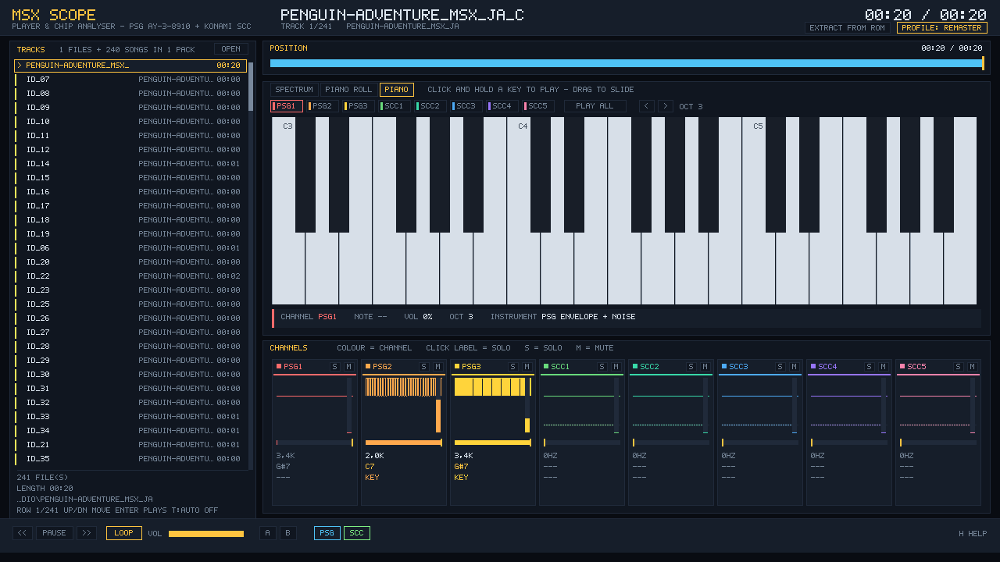
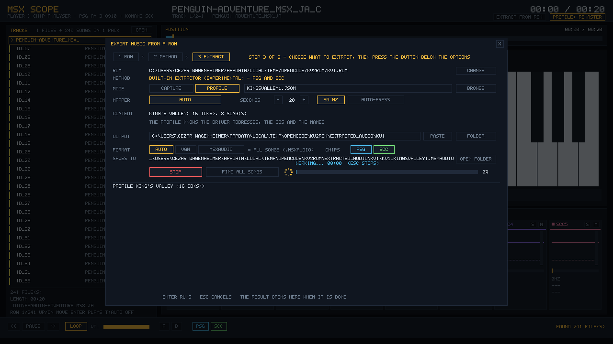
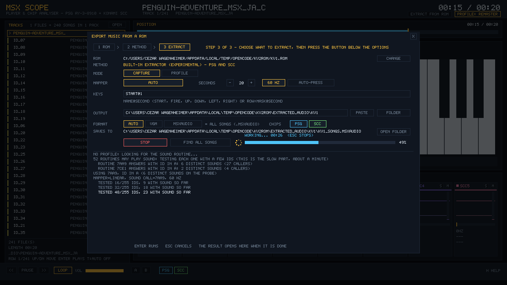
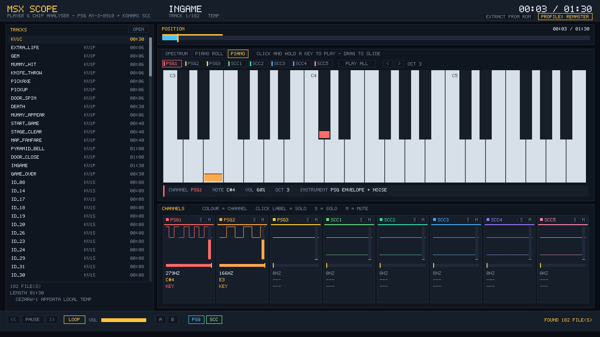

# Wagenheimer.MsxAudio


**MSX audio for .NET** — AY-3-8910 (PSG) and Konami SCC emulation, VGM playback/recording, **ROM music
extraction** (an in-process MSX that runs a cartridge's own sound driver) and a game-ready streaming
engine with its own `.msxaudio` library format.

**MSXScope** — the visual player included in the repo: VGM playback with per-channel PSG/SCC strips,
spectrum in dB, piano roll with a whole-song map, a playable piano that auditions the song's own
instruments, and GIF/MP4 export.

[](https://www.nuget.org/packages/Wagenheimer.MsxAudio)
[](https://www.nuget.org/packages/Wagenheimer.MsxAudio.MonoGame)
[](https://www.nuget.org/packages/Wagenheimer.MsxAudio)
[](https://github.com/wagenheimer/MsxAudio/actions/workflows/ci.yml)
[](https://github.com/wagenheimer/MsxAudio/actions/workflows/release.yml)
[](https://github.com/wagenheimer/MsxAudio/releases)
[](LICENSE)
[](#requirements)
[](#architecture)

```bash
dotnet add package Wagenheimer.MsxAudio            # engine-agnostic core (pure C#)
dotnet add package Wagenheimer.MsxAudio.MonoGame  # optional MonoGame bridge
```

<p align="center"></p>

---

## Table of contents

- [Why this package exists](#why-this-package-exists)
- [The chips](#the-chips)
- [Requirements](#requirements)
- [Quick start](#quick-start)
- [Downloads](#downloads)
- [MSXScope (visual player)](#msxscope-visual-player)
- [Screens](#screens)
- [The `.msxaudio` format](#the-msxaudio-format)
- [Playback engine](#playback-engine)
- [Extracting music from a ROM](#extracting-music-from-a-rom)
- [CLI](#cli)
- [Mixing profiles](#mixing-profiles)
- [Validation](#validation)
- [Architecture](#architecture)
- [Versioning](#versioning)
- [Status and roadmap](#status-and-roadmap)
- [Tests](#tests)
- [Legal](#legal)

---

## Why this package exists

MSX game audio *is what the chips played* — not a recording. This package stores and plays the
**register writes** (the VGM), which is the lossless source of truth: a few KB per song, a sample
accurate loop, and the exact timbre on any machine, with no codec in between.

| Problem with the "record a WAV/OGG" route | How this package solves it |
| :--- | :--- |
| click at the loop seam (time based cut) | the loop is detected in the write stream, and the streaming engine **never restarts the chip** (continuous loop) |
| codec artefacts, inconsistent level | chip render at 4–8× oversampling + FIR decimation, level calibrated to hardware |
| hundreds of MB of rendered audio | a few KB of VGM, rendered in real time |
| losing the extraction | a `.msxaudio` (ZIP) package with a manifest + VGMs, versionable |

## The chips

| Chip | Implementation | What is emulated |
| :--- | :--- | :--- |
| **PSG AY-3-8910** | port of **emu2149** (the same core used by VGMPlay) | 3 square channels, 17-bit LFSR noise, 16 envelope shapes, the AY volume table |
| **Konami SCC (K051649)** | port of the **MAME/libvgm** core | 5 wavetable channels (32 bytes each), 16.16 phase accumulator, key-on at `0x8F`, channel 5 sharing the wave of channel 4 |

MSX clocks: PSG **1,789,772.5 Hz** (divide by 16) and SCC **1,789,772.5 Hz** in VGMs
(`f = clock / (16 × (period + 1))`, equivalent to `3579545 / (32 × (period + 1))`).

## Requirements

| Piece | Version |
| :--- | :--- |
| .NET | **10** (`net10.0`) |
| MonoGame (only for the bridge and the visualizer) | 3.8 (`MonoGame.Framework.DesktopGL`) |
| openMSX (optional: reference extraction path, and its `softwaredb.xml` for mapper detection) | 19+ (portable build works) |

The core has **no engine dependency** and targets `net10.0` with nullable enabled.

## Quick start

```csharp
using Wagenheimer.MsxAudio.Songs;
using Wagenheimer.MsxAudio.Playback;
using Wagenheimer.MsxAudio.Mixing;

using var library = MsxAudioLibrary.Load("Content/Audio/kingsvalley.msxaudio");
using var engine  = new MsxAudioEngine(library, AudioProfile.Original);

engine.PlaySong("stage_a");     // loop handled by the manifest
engine.PlaySample("jump");      // short VGM or WAV clip
```

MonoGame bridge:

```csharp
using Wagenheimer.MsxAudio.MonoGame;

var player = new MsxAudioPlayer(engine);   // DynamicSoundEffectInstance (streaming)
player.Start();
player.PlaySong("menu");
player.PlaySample("password_key");

// in Update():
player.Update();                           // keeps the buffer queue full
```

`Render(float[] destination, int frames)` also gives you **interleaved stereo** if you want to feed
another backend (SDL, NAudio, a custom mixer, the visualizer…).

## Downloads

**MSXScope** is built for six targets by GitHub Actions, self-contained (no .NET install needed):

| OS | Architectures | Archive |
| :--- | :--- | :--- |
| Windows | x64, arm64 | `.zip` |
| Linux | x64, arm64 | `.tar.gz` |
| macOS | x64 (Intel), arm64 (Apple silicon) | `.tar.gz` |

- **Releases** (`v*` tags) attach all six archives: [github.com/wagenheimer/MsxAudio/releases](https://github.com/wagenheimer/MsxAudio/releases).
- **Every push to `main`** publishes the same builds as workflow artifacts (30-day retention) in the
  [MSXScope builds](https://github.com/wagenheimer/MsxAudio/actions/workflows/release.yml) tab.
- Unpack and run `MSXScope` (on macOS/Linux the binary keeps the executable bit; macOS may ask to
  confirm the first launch because the app is not code-signed).

## MSXScope (visual player)

**MSXScope** (`tools/MsxAudioVisualizer`) opens a **VGM** (file, folder or *drag & drop*), plays it in real time and
shows everything the chips are doing. **F2** (or the `OPEN` button in the playlist) opens an in-app
folder browser with a **clickable breadcrumb** (each segment jumps to that level, long paths collapse
the middle), a `..` row, **recent folders** and a **recursive** option, so you can browse a whole
collection without leaving the player; the last folder, view, profile and window size are remembered
between runs (`%APPDATA%\MsxAudio\visualizer.json`, or a `visualizer.json` next to the executable for
a portable install).

| Key | Action |
| :--- | :--- |
| `F2` / `Ctrl+O` | open the **folder browser** (recursive option inside) |
| `F5` | rescan the current folder |
| `↑` / `↓` | select and play a track |
| `PgUp` / `PgDn` (or the wheel / scrollbar) | scroll the track list without changing the song |
| `Enter` (or click) | play the selected track |
| `Space` | pause / resume |
| `←` / `→` | seek -/+ 5 s (rebuilds the chip state) |
| `P` / `S` | toggle **PSG** / **SCC** |
| `1 2 3` | PSG channels 1..3 |
| `4 5 6 7 8` | SCC channels 1..5 |
| `O` | **mixing profile dialog** (with the details of each profile) |
| `Shift+O` | cycle the profile without opening the dialog |
| `A` / `B` | set the **A-B loop** at the current position (`A` twice clears it) |
| `L` | auto-next |
| `Tab` (or the header button) | cycle **spectrum** → **piano roll** → **piano** |
| `R` | restart |
| `H` | help overlay |
| `Esc` | close a dialog, otherwise quit |

In the **piano** view:

| Action | Result |
| :--- | :--- |
| click **and hold** a key | plays that note with the **selected channel's instrument** for as long as you hold it (works while paused); drag across the keys to slide |
| `PSG1…SCC5` | selects which channel's instrument the keys use |
| `PLAY ALL` | walks the **audible** channels, playing each instrument at the note the song is using |
| `<` / `>` | shifts the keyboard one octave (3 octaves on screen) |

## Screens

| Spectrum (dB + peak hold) | Piano roll (song map + chords) |
| :---: | :---: |
|  |  |
| **Piano** (hold a key, stacked notes) | **Folder browser** (breadcrumb, recents) |
|  |  |
| **Mixing profiles** | **Help** (with the build version) |
|  |  |
| **Extract from ROM** (DETECTED line, 50/60 Hz, auto-press) | **Profile mode** (full song list, named) |
|  |  |
| **Cartridge picker** (`*.rom`/`.zip`, breadcrumb) | **FIND ALL SONGS** (progress and log) |
|  |  |
| **A `.msxaudio` package in the playlist** | |
|  | |

What you see:

- **POSITION** bar with `current / total`, the loop window and a marker — click or drag to seek;
- the **transport bar** at the bottom: previous / play-pause / next, **LOOP**, **volume**, the
  **A-B loop** (its A/B points also appear on the POSITION bar) and the **PSG / SCC** chip toggles.
  The track list scrolls with the wheel, `PgUp`/`PgDn` or its draggable scrollbar;
- **SPECTRUM** in **dB** (`0` to `-60 dB`) with a frequency axis at **100 Hz / 1 kHz / 10 kHz** and
  **peak-hold caps**, so the quiet harmonics and short transients stay visible;
- **PIANO ROLL**: the last 12 s with a **mini keyboard** on the left, octave lines, time grid, one
  colour per channel, and a short tail on every note so fast arpeggios stay **stacked as chords**;
  muted/soloed channels draw dimmed. Under it, a **whole-song map** (one row per channel, brightness =
  activity) shows where the song is busy and where it is calm — **click or drag it to jump** anywhere;
- **PIANO** with three octaves: the bars under each key show which **notes the song is playing** right
  now (one colour per channel, **stacked** when two channels play the same note), and clicking a key
  auditions that instrument — the same PSG envelope/ noise and SCC wave the song uses, mixed over the
  music. The note lasts as long as the mouse button is held. **Mute/solo also apply here**: a muted
  channel (or one filtered out by solo) stops lighting its keys and fades its selector, so the
  keyboard shows exactly what is being heard. The footer has **PSG / SCC** buttons (same as the
  `P` / `S` keys) to mute a chip;
- the **MASTER** oscilloscope and the per-channel scopes draw a **min/max envelope** per pixel column,
  so peaks stay visible instead of being averaged away;
- one strip per channel with live oscilloscope, volume, level with **peak hold**, frequency, nearest
  **note**, key state and — for SCC — the **32-sample wave RAM**. Each channel has its **own colour**
  (PSG warm, SCC cool) and the strip is painted with it — the strip header works as the legend for the
  roll and the piano, which use the same palette;
- **Solo** by clicking a channel label (or its `S` button) and **Mute** through the `M` button.

The UI renders to a fixed **1280×720** render target and is letterboxed into the window, so
resizing/maximising never moves anything.

```bash
# live
dotnet run --project tools/MsxAudioVisualizer -- "music/stage_a.vgm"

# screenshot for docs/CI
MSXAUDIO_SHOT=shot.png MSXAUDIO_SHOT_FRAME=200 dotnet run --project tools/MsxAudioVisualizer -- "music/stage_a.vgm"

# screenshot of the extraction dialog, pre-filled and (with MSXAUDIO_EXTRACT) already running
MSXAUDIO_DIALOG=extract MSXAUDIO_ROM=game.rom MSXAUDIO_ROM_KEYS=START@1 \
  MSXAUDIO_ROM_SECONDS=20 MSXAUDIO_EXTRACT=1 \
  MSXAUDIO_SHOT=extract.png MSXAUDIO_SHOT_FRAME=200 dotnet run --project tools/MsxAudioVisualizer

# same, but in PROFILE mode (all songs by id) or running the id scan
MSXAUDIO_DIALOG=extract MSXAUDIO_ROM=kv1.rom MSXAUDIO_ROM_PROFILE=profiles/kingsvalley1.json \
  MSXAUDIO_EXTRACT=1 MSXAUDIO_SHOT=extract-profile.png MSXAUDIO_SHOT_FRAME=20 \
  dotnet run --project tools/MsxAudioVisualizer
MSXAUDIO_DIALOG=extract MSXAUDIO_ROM=game.rom MSXAUDIO_EXTRACT=scan \
  MSXAUDIO_SHOT=scan.png MSXAUDIO_SHOT_FRAME=4000 dotnet run --project tools/MsxAudioVisualizer

# record a GIF with the built-in encoder (no ffmpeg needed), 640×360 — GIF is silent by format
MSXScope music/stage_a.vgm --record out.gif --seconds 10 --fps 15

# record an MP4 **with audio**: the same samples that are heard go to out.wav and ffmpeg muxes
# frames + WAV (without ffmpeg the frames and the WAV are kept and the exact command is printed)
MSXScope music/stage_a.vgm --record out.mp4 --seconds 20 --fps 30

# audio only (no window): renders the segment to a WAV using the same chips/profile
MSXScope music/stage_a.vgm --audio-only out.wav --seconds 30 --profile remaster

# window size
MSXScope music/stage_a.vgm --width 1600 --height 900

# start with the piano roll instead of the spectrum
MSXScope music/stage_a.vgm --roll

# start on the playable piano
MSXScope music/stage_a.vgm --view piano

# open a collection (all .vgm below the folder)
MSXScope "C:\music\msx" --recursive
```

Recording is **deterministic**: every frame advances exactly `1/fps` seconds of music, independent of
the machine frame rate — so the WAV timeline matches the video exactly.

## The `.msxaudio` format

A ZIP with a manifest and the VGMs:

```
manifest.json
songs/stage_a.vgm
clips/jump.vgm
```

`manifest.json` carries the title, origin, clocks and, per song, `loop`, `loopStart`, `loopSeconds`,
`seconds` and `originalId` (the id of the ROM's sound routine).

## Playback engine

- **Streaming music**: the VGM is consumed while it plays; the loop is continuous (the chip state is
  never restarted). Each track costs only its VGM — no pre-rendered PCM.
- **Sample player**: effects as PCM with volume, pan and polyphony (`MaxSampleVoices`, steals the
  oldest). An effect stored as a short VGM is rendered once and cached.
- **Volume buses**: `MusicVolume`, `SampleVolume`, `MasterVolume`.
- **Mute/solo aware**: profiles and per-channel gain changes apply without a pop.

## Extracting music from a ROM

There is **no standard music format on MSX**: each game ships its own driver, and the music only
exists while that driver runs. So nothing here "decodes" a file — the cartridge's driver is executed
on a minimal MSX machine and its PSG/SCC writes are recorded.

> **Deep dive:** [`docs/EXTRACTION.md`](docs/EXTRACTION.md) — the machine, the mappers and how one is
> chosen, the three modes, the diagnosis report, what works per game and the known limits.

The machine (`MiniMsx`) models what drivers touch: primary slots and 64 KB of RAM, the Konami / Konami
SCC / ASCII8 / ASCII16 / R-Type mappers, the PPI (slot register, keyboard, joystick), the PSG with its
read-back, the VDP vblank, the BIOS entries games call, and **T-state timestamps** on every recorded
write, at 60 Hz or 50 Hz. The mapper is looked up by SHA-1 in an openMSX `softwaredb.xml` when one is
found and guessed with openMSX's own rules otherwise.

### From the player

`F3` (or the **EXPORT MUSIC FROM A ROM** chip) opens a three-step assistant. Every step says what it
is for:

| Step | What you do | What the app does |
| :--- | :--- | :--- |
| **1 ROM** | pick a `.rom`, or the `.zip` exactly as downloaded (type, paste, browse) | opens the zip by itself, shows size, mapper (and where it came from), header and SHA-1, and **runs the game for 8 s** to see which chips it uses |
| **2 METHOD** | choose **openMSX** or the **built-in extractor (experimental)** | recommends one from the test run; offers to **download and install openMSX** when it is missing |
| **3 EXTRACT** | choose what to extract and press the button | runs it with a spinner, elapsed time and progress, then opens the result in the player |

<table><tr>
<td></td>
<td></td>
</tr></table>

| Method | Chips it hears | Good for |
| :--- | :--- | :--- |
| **openMSX** | PSG, SCC, SCC+, MSX-MUSIC (FM), MSX-AUDIO | exact results, and any game that uses FM; needs openMSX (free, ~9 MB) |
| **Built-in** | PSG and SCC | nothing to install, fast, and it can **find every song by itself** |

**openMSX is never bundled** (it is GPL). If it is not found (setting, `MSXAUDIO_OPENMSX`, the install
folder, Program Files or `PATH`), step 2 shows **DOWNLOAD AND INSTALL**: the portable build is fetched
from the project's own GitHub releases, checked against its published size and SHA-256 and unpacked in
`%LOCALAPPDATA%\MsxAudio\openmsx` (no admin rights). **I ALREADY HAVE IT** takes a pasted path instead.
openMSX captures what plays (with auto-press) or runs a profile; **FIND ALL SONGS** needs the built-in
extractor.

In step 3 you can also choose 60/50 Hz and whether to **AUTO-PRESS** the fire button and space bar,
and pick a mode:

| Mode | What it does | When to use |
| :--- | :--- | :--- |
| **CAPTURE** | boots the ROM and records what it plays after the key script | any cartridge; grabs a title theme or a gameplay window |
| **PROFILE** | reads a `.json` with the driver's addresses, ids and names | the full song list, with names (see `profiles/`) |
| **FIND ALL SONGS** | finds the "play sound" routine (in any ROM bank, with the id in `A`/`HL`/`DE`/`BC`), then probes every id | no profile yet: a first list named `id_NN` |

The result is written to `<rom folder>/extracted_audio/<rom name>` and opens straight in the player.
When nothing plays, the log says **why** (missing header, a chip that is not emulated, a BIOS service
the game kept calling) instead of leaving you with a silent file.

### From the CLI

```bash
# what is this ROM? (size, SHA-1, mapper and its source, header)
MsxAudioTool rom-info "rom.zip"

# whatever the game plays: boot it, send buttons, record
MsxAudioTool capture "rom.zip" title.vgm --seconds 30 --keys "START@1"
MsxAudioTool capture "rom.zip" title.vgm --seconds 40 --auto 1            # tap fire/space by itself
MsxAudioTool capture "rom.zip" title.vgm --seconds 40 --refresh 50        # a PAL game

# find every sound id, no profile needed
MsxAudioTool scan game.rom game_songs.msxaudio --seconds 12
MsxAudioTool scan game.rom game_songs.msxaudio --call 0x432E --bank 0 --id-reg A

# full named list from a curated profile
MsxAudioTool extract-direct "rom.msx" game.msxaudio --profile profiles/kingsvalley2.json

# boot diagnostics: mapper, hooks, hot addresses, and what the game needed that is missing
MsxAudioTool probe "rom.msx"
```

| Key script | Meaning |
| :--- | :--- |
| `START@1` | joystick trigger A one second after boot (the usual "press start") |
| `FIRE@1, RIGHT@3` | several presses, comma separated |
| `TRIGGER-B@2` | the second joystick button |
| `UP` / `DOWN` / `LEFT` / `RIGHT` | joystick directions (`@seconds` optional, default 1 s) |
| `8:1@2` | raw matrix: keyboard **row 8, bit 1**, two seconds after boot |

### Profiles

A profile (`profiles/*.json`) names the driver's addresses so a game can be extracted completely, with
names and durations. `profiles/kingsvalley2.json` (Konami, 1988):

```json
{
  "name": "King's Valley II",
  "soundCallAddress": 17198,
  "stopId": 1,
  "ids": [1,2,3,4,5,6,7,8,9,10,11,12,13,14,15,16,17,18,19,20],
  "musicIds": [3,5,6,7,8,9,10,13,14,17,18],
  "secondsPerId": 12,
  "secondsPerSong": 120,
  "secondsById": { "9": 300 }
}
```

Other fields: `soundCallBank`, `idRegister` (`A`/`HL`/`DE`/`BC`), `playerAddress` (run **only the sound
driver**, for games whose interrupt handler also runs the whole game, like King's Valley 1),
`resetAddresses`, `idMask`, `romType` and `refreshRate` — all documented in
[`docs/EXTRACTION.md`](docs/EXTRACTION.md). Songs with long loops need longer captures (use
`secondsById`).

### Status per game

| Game | Cartridge | Result |
| :--- | :--- | :--- |
| King's Valley 1 | 16 KB, linear, PSG | capture ✅ · profile: **8 songs + 8 effects** ✅ · scan finds `setMusic` by itself (29 sounds) ✅ |
| King's Valley II | 128 KB, Konami SCC | capture ✅ (5.9k pitch writes in 15 s) · profile: full named list ✅ |
| Penguin Adventure | 128 KB, Konami (4), PSG | capture ✅ — music now recorded (it was silent before the Konami-mapper fix) |

Games whose music is on **MSX-MUSIC, MSX-AUDIO, SCC+ or MoonSound** are detected and reported, not
recorded yet. The openMSX path (`MsxAudioTool extract`) remains the bit-exact reference for those.

### With openMSX (reference path)

The same extraction can drive **openMSX** (the emulator does the VDP, CPU, mapper and every chip) and
inject `CALL <sound routine>` with each id, recording the VGM with its `vgm_rec`:

```bash
MsxAudioTool extract "King's Valley II (JP)[RC-760].rom" kingsvalley.msxaudio \
    --profile profiles/kingsvalley2.json --openmsx tools/omsx/openmsx.exe
```

## CLI

```bash
MsxAudioTool import <vgm-folder> <out.msxaudio> [--title T] [--clips]
MsxAudioTool info <package.msxaudio>
MsxAudioTool extract <rom> <out.msxaudio> --profile profile.json [--openmsx path]
MsxAudioTool extract-direct <rom> <out.msxaudio> --profile profile.json
MsxAudioTool capture <rom> <out.vgm> [--seconds N] [--mapper M] [--keys "START@1,RIGHT@3"] [--auto 1] [--refresh 50|60]
MsxAudioTool scan <rom> <out.msxaudio> [--ids 1-63] [--call ADDR] [--bank N] [--id-reg A|HL|DE|BC]
                  [--player ADDR] [--profile p.json] [--refresh 50|60]
MsxAudioTool probe <rom> [--mapper M] [--refresh 50|60]
MsxAudioTool rom-info <rom>
MsxAudioTool render <package.msxaudio> <id|all> <out.wav> [--profile original|stereo|remaster]
MsxAudioTool verify <vgm> <capture.wav>
MsxAudioTool unpack <package.msxaudio> <folder>
```

## Mixing profiles

| Profile | What changes |
| :--- | :--- |
| `original` | faithful: all 8 channels centred, only the DC cut |
| `stereo` | PSG at −30/0/+30 % and SCC at −55/−25/0/+25/+55 % + 16 kHz low-pass |
| `remaster` | 8× oversampling, wider pan, 17 kHz low-pass, short reverb, peak normalisation |

> Profiles only change **how** the chips are mixed. The chips themselves are toggled with `P` / `S`
> (or the **PSG / SCC** buttons in the transport bar of the visualizer).

## Validation

Against openMSX recordings of the same VGM:

| Measurement | Result |
| :--- | :--- |
| LTAS (mean spectral shape) | correlation **0.998** |
| Amplitude envelope | correlation **0.95** (constant offset ≈ `record` latency) |
| Level | **0.3 dB** difference (calibrated in `AudioProfile.DefaultMasterGain`) |
| Loop seam (one round render) | jump **0.025** against a typical delta of **0.047** |

Sample-by-sample correlation is not a valid metric here: openMSX's `record` resamples and delays, and
a fraction of a millisecond misaligns a square wave.

## Architecture

```
src/Wagenheimer.MsxAudio/             core (pure C#, no engine dependency)
  Chips/       Ay8910, KonamiScc
  Vgm/         VgmFile, VgmWriter, VgmLoopFinder
  Mixing/      AudioProfile, MsxSoundRenderer, FirDecimator, Biquad, StereoReverb
  Songs/       MsxAudioLibrary (.msxaudio)
  Playback/    MsxAudioEngine, WavDecoder
  Extraction/  MiniMsx (the machine), RomMapper, RomInfo (+ softwaredb), RomCapture, RomSoundScan,
               DirectRomExtractor (+ profiles), OpenMsxRomExtractor, VgmImporter
src/Wagenheimer.MsxAudio.MonoGame/    MsxAudioPlayer (DynamicSoundEffectInstance)
tools/MsxAudioTool/                   extractor/import/export CLI
tools/MsxAudioVisualizer/             MSXScope: MonoGame visual player (PSG/SCC, GIF/MP4 export)
tests/Wagenheimer.MsxAudio.Tests/     chips, VGM, package, engine, MSX machine
profiles/                             per-game extraction profiles (JSON)
```

## Versioning

The library follows [Semantic Versioning](https://semver.org/) (`Wagenheimer.MsxAudio` is at 1.0.0)
and the changelog is in [CHANGELOG.md](CHANGELOG.md). **MSXScope** takes its version from the git
tag through [MinVer](https://github.com/adamralph/minver):

```bash
MSXScope --version                 # e.g. 1.0.0, or 1.0.1-alpha.0.7 between tags
git tag v1.2.0 && git push origin v1.2.0   # publishes a release with the six archives
```

`v*` tags produce a GitHub Release; commits after a tag are versioned
`<next>-alpha.0.<commit count>`, so every build is traceable to a commit without hand-editing a
version file.

## Status and roadmap

| Area | State |
| :--- | :--- |
| PSG + SCC emulation | ✅ validated against openMSX (LTAS correlation 0.998) |
| VGM import/export, loop detection | ✅ |
| `.msxaudio` package | ✅ |
| Streaming engine + sample player | ✅ (parity test with the offline renderer) |
| MonoGame bridge | ✅ |
| Visual player (per-channel view, GIF/MP4 export) | ✅ |
| ROM extraction via openMSX | ✅ (bit-exact reference path) |
| ROM extraction in process (PSG + SCC) | ✅ capture, profile and scan; slots, 6 mappers, T-state timing, 50/60 Hz |
| ROM extraction: MSX-MUSIC / MSX-AUDIO / SCC+ | ⏳ detected and reported, not recorded yet |
| Remaster profile (stereo/reverb) | ✅ |

### Roadmap

1. Record MSX-MUSIC (YM2413) and SCC+ in the in-process machine (VGM already has the commands).
2. Find a game's per-frame sound player automatically, so the scan can silence the game's own music.
3. Rename scanned ids in the player and write the package back.
4. A `play` CLI command that streams through `MsxAudioEngine` (live preview).
5. Optional `SoundEffect`-based player for projects that cannot use `DynamicSoundEffectInstance`.

## Tests

```bash
dotnet test MsxAudio.slnx
```

Covers chip frequencies (PSG/SCC formulas), VGM parse/write round-trip, loop detection, package IO,
the streaming engine (loop continuity, sample voices, volume), streaming vs offline parity, WAV
decoding and the built-in MSX machine: every mapper, the SCC window rule, slots and `ENASLT`, the
PPI, PSG read-back, `HALT` timing, T-state timestamps, 50/60 Hz, mapper detection, the diagnosis and
the bank-aware sound scan.

## Legal

MSX games, their art and their music belong to their authors (Konami, for King's Valley). This
package does **not** ship ROMs or extracted data: it emulates the chips and reads VGM files and
packages that **you** generate from your own ROM. Use it only with material you are allowed to use.
