# Wagenheimer.MsxAudio


**MSX audio for .NET.** Emulation of the two chips of the MSX (the **AY-3-8910 PSG** and the **Konami SCC**),
VGM playback and recording, a game-ready streaming engine with its own `.msxaudio` library format, an
**automatic mixer** that makes the old chips sound modern, **export to WAV / MP3 / MIDI**, and
**extraction of music straight from a ROM** (an in-process MSX runs the cartridge's own sound driver).

**MSXScope** is the visual player that comes with it: every channel of both chips live, spectrum,
piano roll, a playable piano that uses the song's own instruments, an assistant that exports music from a
cartridge, and GIF/MP4 recording.

[](https://www.nuget.org/packages/Wagenheimer.MsxAudio)
[](https://www.nuget.org/packages/Wagenheimer.MsxAudio.MonoGame)
[](https://www.nuget.org/packages/Wagenheimer.MsxAudio)
[](https://github.com/wagenheimer/MsxAudio/actions/workflows/ci.yml)
[](https://github.com/wagenheimer/MsxAudio/actions/workflows/release.yml)
[](https://github.com/wagenheimer/MsxAudio/releases)
[](LICENSE)
[](#requirements)
[](#architecture)

```bash
dotnet add package Wagenheimer.MsxAudio            # engine-agnostic core (pure C#)
dotnet add package Wagenheimer.MsxAudio.MonoGame  # optional MonoGame bridge
```

<p align="center"></p>

## Highlights

- **Two chips, validated against openMSX**: PSG (emu2149 core) and SCC (MAME/libvgm core), 4-8x oversampled
  and decimated with an FIR filter. Spectral shape correlation with openMSX recordings: **0.998**.
- **Register-level audio**: songs are VGMs (the chip writes), a few KB each, with a sample-accurate loop and no
  codec. A `.msxaudio` package holds a whole game's music and effects.
- **Auto mix**: the notes are analysed to find the tune, the bass, the arpeggios, the pads and the drums;
  each gets its own level, pan, tone, echo (in the tempo of the song) and reverb, then a compressor and a
  limiter. [Details](#mixing-profiles).
- **Export** the current song or a whole list as **WAV**, **MP3** (LAME) and/or **MIDI**, with loops repeated,
  a fade-out and every song at the same loudness (-14 LUFS). The MIDI has the tempo detected, notes on a 16th
  grid, arpeggios as held chords, vibrato as pitch bend and the chip volume as expression.
  [Details](#exporting-audio-wav-mp3-midi).
- **Music from a ROM**: a three-step assistant picks the method (openMSX, which it can download and install,
  or the built-in extractor), recognises the game, and **extracts every song by itself** with one button.
  [Details](#extracting-music-from-a-rom).
- **A player worth keeping open**: packs fold, songs rename and delete, the keyboard drives the list, a real
  transport with *AT END: loop / next / stop*, and per-channel strips that show what each voice does.

## Table of contents

- [Why this package exists](#why-this-package-exists)
- [The chips](#the-chips)
- [Requirements](#requirements)
- [Quick start](#quick-start)
- [Downloads](#downloads)
- [MSXScope, a tour](#msxscope-a-tour)
  - [The three views](#the-three-views)
  - [Playing, the track list and packs](#playing-the-track-list-and-packs)
  - [Mixing profiles](#mixing-profiles)
  - [Exporting audio (WAV, MP3, MIDI)](#exporting-audio-wav-mp3-midi)
  - [Extracting music from a ROM](#extracting-music-from-a-rom)
  - [Keyboard and mouse](#keyboard-and-mouse)
  - [Command line of the player](#command-line-of-the-player)
- [Using the library](#using-the-library)
- [The `.msxaudio` format](#the-msxaudio-format)
- [Extraction in depth](#extraction-in-depth)
- [CLI tool](#cli-tool)
- [Validation](#validation)
- [Architecture](#architecture)
- [Versioning](#versioning)
- [Status and roadmap](#status-and-roadmap)
- [Tests](#tests)
- [Credits and legal](#credits-and-legal)

---

## Why this package exists

MSX game audio *is what the chips played*, not a recording. This package stores and plays the
**register writes** (the VGM), which is the lossless source of truth: a few KB per song, a sample accurate
loop, and the exact timbre on any machine, with no codec in between.

| Problem with the "record a WAV/OGG" route | How this package solves it |
| :--- | :--- |
| click at the loop seam (time based cut) | the loop is detected in the write stream and the streaming engine **never restarts the chip** (continuous loop) |
| codec artefacts, inconsistent level | chip render at 4-8x oversampling + FIR decimation, level calibrated to hardware, optional loudness normalisation |
| hundreds of MB of rendered audio | a few KB of VGM, rendered in real time |
| a recording cannot be remixed | the notes are in the data: re-mix per channel, or export them as MIDI |
| losing the extraction | a `.msxaudio` (ZIP) package with a manifest and the VGMs, versionable |

## The chips

| Chip | Implementation | What is emulated |
| :--- | :--- | :--- |
| **PSG AY-3-8910** | port of **emu2149** (the core VGMPlay uses) | 3 square channels, 17-bit LFSR noise, 16 envelope shapes, the AY volume table |
| **Konami SCC (K051649)** | port of the **MAME/libvgm** core | 5 wavetable channels (32 bytes each), 16.16 phase accumulator, key-on at `0x8F`, channel 5 sharing the wave of channel 4 |

MSX clocks: PSG **1,789,772.5 Hz** (divide by 16) and SCC **1,789,772.5 Hz** in VGMs
(`f = clock / (16 x (period + 1))`, equivalent to `3579545 / (32 x (period + 1))`).

## Requirements

| Piece | Version |
| :--- | :--- |
| .NET | **10** (`net10.0`) |
| MonoGame (the bridge and the player only) | 3.8 (`MonoGame.Framework.DesktopGL`) |
| LAME (MP3 export, in the player only) | through `NAudio.Lame` 2.1 (Windows has it built in; Linux/macOS need `libmp3lame`) |
| openMSX (optional) | 19+. Reference extraction path, and its `softwaredb.xml` for mapper detection. The player can **download the portable build for you** |
| ffmpeg (optional) | only to mux an MP4 **with sound** from the player's recorder (a GIF needs nothing) |

The core has **no engine dependency**, targets `net10.0` and has nullable enabled.

## Quick start

```csharp
using Wagenheimer.MsxAudio.Songs;
using Wagenheimer.MsxAudio.Playback;
using Wagenheimer.MsxAudio.Mixing;

using var library = MsxAudioLibrary.Load("Content/Audio/kingsvalley.msxaudio");
using var engine  = new MsxAudioEngine(library, AudioProfile.Auto);

engine.PlaySong("stage_a");     // loop handled by the manifest
engine.PlaySample("jump");      // short VGM or WAV clip
```

MonoGame bridge:

```csharp
using Wagenheimer.MsxAudio.MonoGame;

var player = new MsxAudioPlayer(engine);   // DynamicSoundEffectInstance (streaming)
player.Start();
player.PlaySong("menu");
player.PlaySample("password_key");

// in Update():
player.Update();                           // keeps the buffer queue full
```

`Render(float[] destination, int frames)` also gives you **interleaved stereo** if you want to feed
another backend (SDL, NAudio, a custom mixer, the visualizer...).

## Downloads

**MSXScope** is built for six targets by GitHub Actions, self-contained (no .NET install needed):

| OS | Architectures | Archive |
| :--- | :--- | :--- |
| Windows | x64, arm64 | `.zip` |
| Linux | x64, arm64 | `.tar.gz` |
| macOS | x64 (Intel), arm64 (Apple silicon) | `.tar.gz` |

- **Releases** (`v*` tags) attach all six archives: [github.com/wagenheimer/MsxAudio/releases](https://github.com/wagenheimer/MsxAudio/releases).
- **Every push to `main`** publishes the same builds as workflow artifacts (30-day retention) in the
  [MSXScope builds](https://github.com/wagenheimer/MsxAudio/actions/workflows/release.yml) tab.
- Unpack and run `MSXScope` (on macOS/Linux the binary keeps the executable bit; macOS may ask to
  confirm the first launch because the app is not code-signed).
- The `profiles/` folder (ready-made extraction profiles) travels with the player.

---

## MSXScope, a tour

**MSXScope** (`tools/MsxAudioVisualizer`) opens a **VGM**, a `.msxaudio` package, a folder or anything you drop
on the window, plays it in real time and shows what the chips are doing. The last folder, view, mixing
profile, loop choice and window size are remembered (`%APPDATA%\MsxAudio\visualizer.json`, or a
`visualizer.json` next to the executable for a portable install). The UI renders to a fixed **1280x720**
target and is letterboxed into the window, so resizing never moves anything.

<p align="center">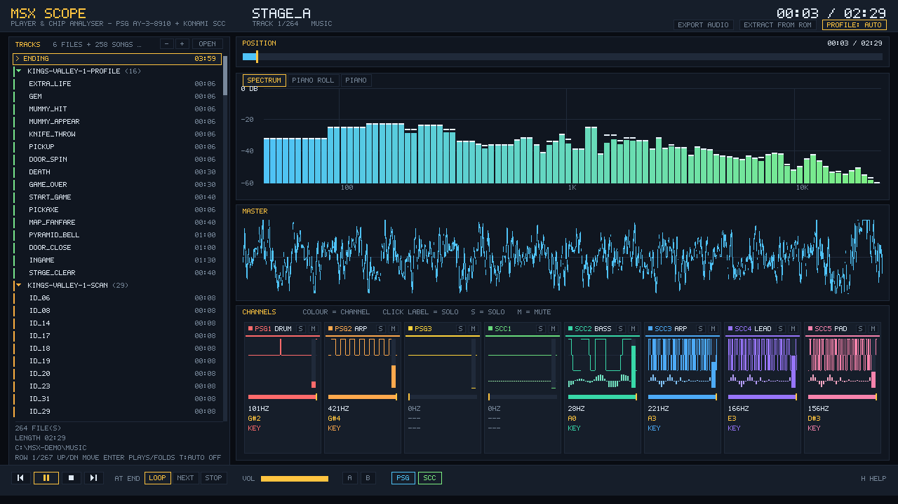</p>

What is on the screen:

- **POSITION** bar with `current / total` and the loop window; click or drag to seek.
- **Transport** at the bottom: previous, play/pause, **stop**, next, the **AT END** choice, volume, the **A-B loop**
  and the **PSG / SCC** switches. Previous restarts the song after 3 s and goes back one song before that.
- **One strip per channel** (3 PSG + 5 SCC) with a live scope, volume, level with peak hold, frequency, nearest
  note, key state and, for the SCC, the **32-sample wave RAM**. Each channel has its own colour, the same in
  the roll and the piano. With the **auto mix** every strip also says what the channel is doing:
  `LEAD`, `BASS`, `ARP`, `PAD` or `DRUM`.
- **Solo** by clicking a channel label (or `S`), **mute** with `M`.
- The **MASTER** scope and the channel scopes draw a min/max envelope per pixel column, so peaks are not
  averaged away.

### The three views

| Spectrum (dB, peak hold) | Piano roll (song map, chords) | Piano (hold a key, stacked notes) |
| :---: | :---: | :---: |
|  | 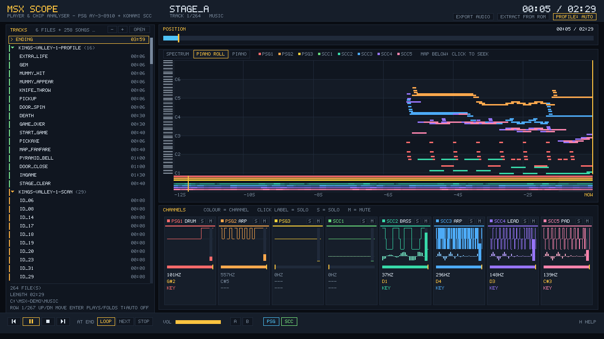 | 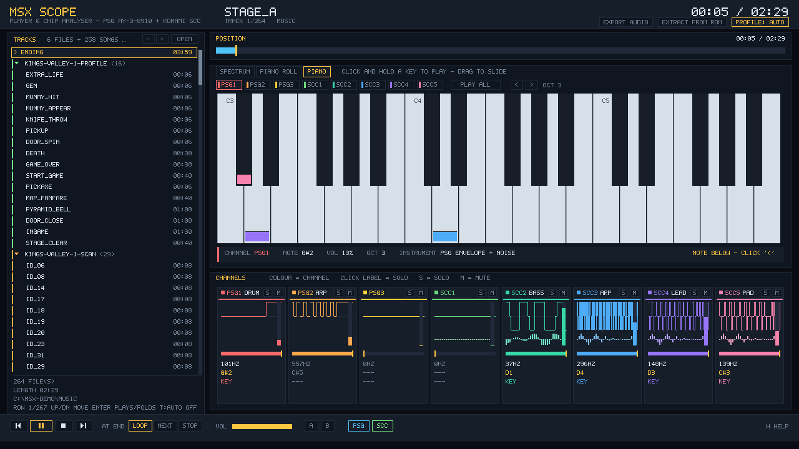 |

- **Spectrum**: `0` to `-60 dB` with a frequency axis at 100 Hz / 1 kHz / 10 kHz and peak-hold caps, so quiet
  harmonics and short transients stay visible.
- **Piano roll**: the last 12 s with a mini keyboard, octave lines, a time grid, one colour per channel and a
  short tail on every note so fast arpeggios stay stacked as chords. Under it, a **song map** (one row per
  channel, brightness = activity) shows where the song is busy: **click or drag it to jump** anywhere.
- **Piano**: three octaves. The bars under each key show the **notes the song plays right now** (stacked when
  two channels play the same note); clicking a key plays that note with **the selected channel's instrument**
  (the same PSG envelope/noise or SCC wave the song uses), for as long as you hold it, even while paused. Mute
  and solo apply here too. `PLAY ALL` walks the audible channels, `<` / `>` shift an octave.

### Playing, the track list and packs

<table><tr>
<td width="50%">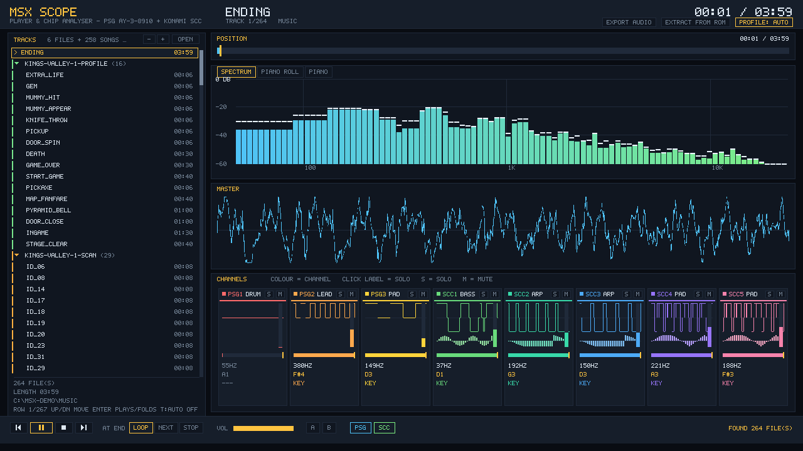</td>
<td width="50%">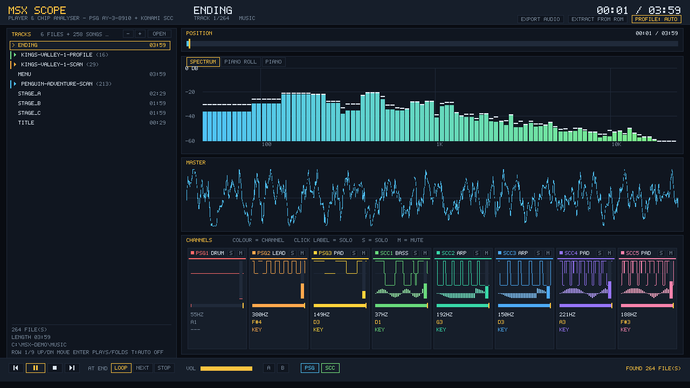</td>
</tr></table>

- A **pack** is one `.msxaudio` file that holds many songs. It shows as a header with the number of songs
  (`KINGS-VALLEY-1-PROFILE (16)`) and a coloured stripe on its songs. `Enter`, a click, or `<-` / `->` on the
  header **fold and unfold** it; the `-` and `+` buttons in the panel header fold or unfold all of them.
  The title bar of the panel summarises the folder: `6 FILES + 258 SONGS IN 3 PACKS`.
- The **keyboard cursor** moves through the rows (`Up`/`Down` repeat when held, `PgUp`/`PgDn`, `Home`/`End`);
  `Enter` plays the row. Browsing does not interrupt the music, unless you turn on **play on move** with `T`.
  The playing song is marked with `>`, the cursor row is outlined, the row under the mouse is lit.
- **AT END** decides what happens when a song ends: **LOOP** repeats it, **NEXT** goes to the next song,
  **STOP** stops and waits at 0:00. `L` cycles the three.

<table><tr>
<td width="50%">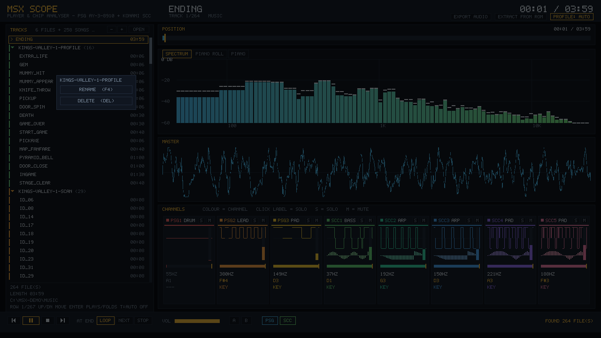</td>
<td width="50%">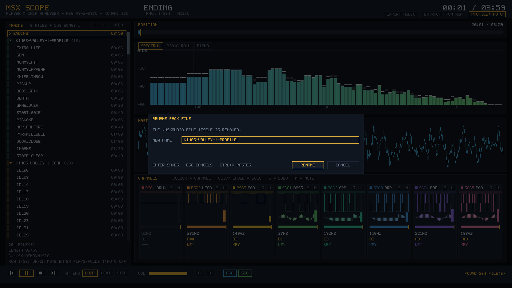</td>
</tr></table>

- **Rename and delete**, also for a song **inside a pack**: right-click a row, or `F4` / `Delete`. A song in a
  pack rewrites the `.msxaudio` (written next to the original and swapped in, so a failure keeps the old file);
  a plain file is renamed on disk or sent to the recycle bin; a pack header renames or deletes the whole file.
  Deleting needs `Y` or a click on DELETE, never just `Enter`.

<table><tr>
<td width="50%">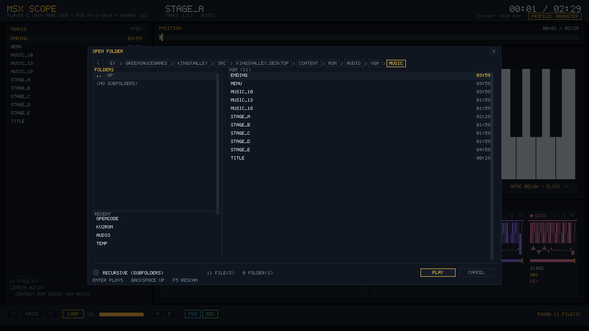</td>
<td width="50%">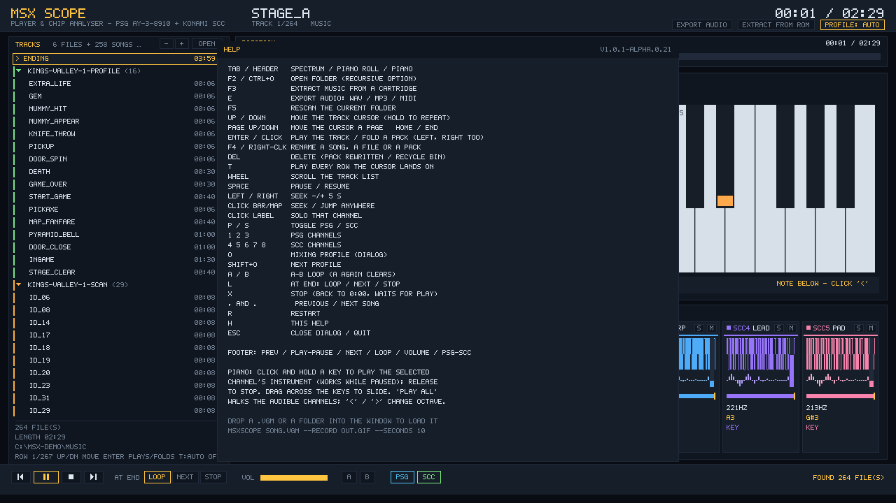</td>
</tr></table>

- **Folder browser** (`F2`): a clickable breadcrumb, a `..` row, **recent folders** with their full path, a
  **recursive** option and an **OPEN FOLDER** button that shows the folder in your file manager. Songs that live
  in a pack are tagged `PACK`, coloured per pack and named after it, so a file that holds many songs never looks
  like many files. `H` shows the full list of shortcuts.

### Mixing profiles

`O` opens the dialog, `Shift+O` cycles. Profiles change **how** the chips are mixed, never the notes.

<p align="center">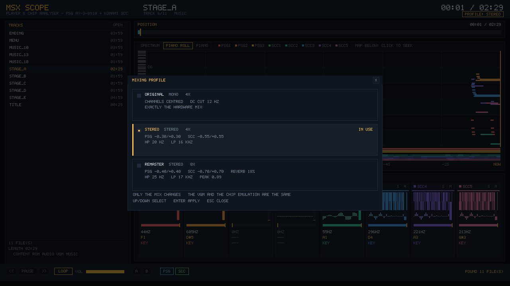</p>

| Profile | What it does |
| :--- | :--- |
| `original` | faithful: the eight channels centred, only a DC cut |
| `stereo` | PSG at -30/0/+30 % and SCC at -55/-25/0/+25/+55 %, low cut 20 Hz, high cut 16 kHz |
| `remaster` | 8x oversampling, wider pan, low cut 25 Hz, high cut 17 kHz, a short reverb, peak normalisation |
| **`auto`** | **mixes each channel by what it does in the song** |

The profile's low cut, high cut and reverb now apply in the **live player** too (they used to apply only when
rendering offline).

**How `auto` works.** The register writes are replayed and every channel is classified from the notes it
plays (not from the waveform):

| Role | How it is recognised | Treatment |
| :--- | :--- | :--- |
| `LEAD` | the loud, busy voice above the bass | slightly right, brighter, a little saturation, echo and reverb |
| `BASS` | the lowest voice (median below ~E3), well under the others | centred, boosted lows, saturation so it carries on small speakers |
| `ARP` | many notes more than 3 semitones apart, in quick succession (a chord played one note at a time) | spread wide, echo that ping-pongs, a touch of reverb |
| `PAD` | accompaniment: chords, counter-melodies | spread, more reverb |
| `DRUM` | PSG channels that are mostly noise | compressed, brighter |

Vibrato (a wobble under 3 semitones) is **not** taken for an arpeggio. The mix then goes through a stereo
**echo set from the song's own tempo** (a dotted eighth on the left, a quarter on the right; a fixed 190/255 ms when no
steady tempo is found), a mid/side widener, a bus compressor (3:1, 5 ms attack, 140 ms release) and a soft
limiter. On the eleven King's Valley songs the result sits at **-13 to -17.5 LUFS** with healthy peaks. The same
code runs in the live player and in `MsxSoundRenderer`.

### Exporting audio (WAV, MP3, MIDI)

`E` or the **EXPORT AUDIO** chip in the header.

<p align="center">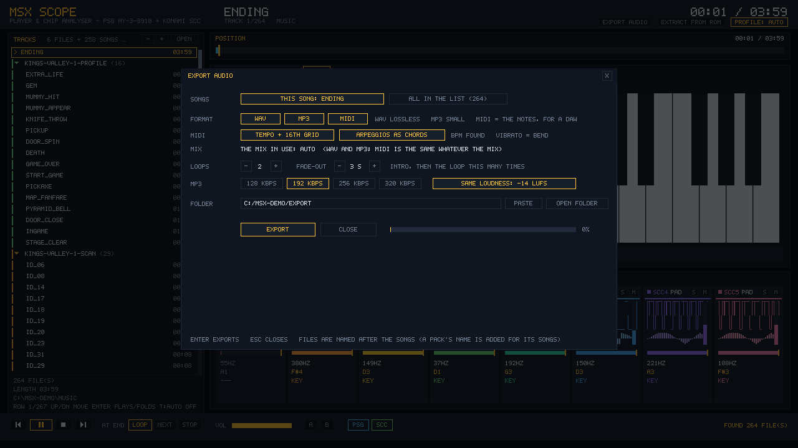</p>

| Format | What you get |
| :--- | :--- |
| **WAV** | 16-bit, 48 kHz, stereo, rendered with the mix in use |
| **MP3** | LAME at 128, 192, 256 or 320 kbps, with an ID3 title |
| **MIDI** | the notes, for a DAW: one track per voice, a drum track, loop markers |

- **Scope**: this song, or **every song in the list**. Any combination of formats at once. Files are named after the
  songs (a pack's name is added to its songs), in a folder you can type, paste or open.
- **Loops and fade-out**: a song with a loop plays its intro, then the loop *N* times, then fades out over the
  seconds you choose. A song without a loop plays to its last note.
- **SAME LOUDNESS: -14 LUFS**: measured with the ITU-R BS.1770 K-weighting and gating, so a whole playlist plays at
  one level; the peak stays under -1 dBFS.

**The MIDI** is a transcription of the chip registers, cleaned up the way a person would:

| Problem of a raw dump | What is done |
| :--- | :--- |
| hundreds of 20 ms notes for an arpeggio | the arpeggio becomes the **held chord** (a chord change starts a new one) |
| vibrato and slides chopped into notes | **pitch bend** inside one note (range 2 semitones, set by RPN) |
| fixed velocity | the chip volume is **expression** (CC11), so decays and swells survive |
| 120 BPM that has nothing to do with the music | the **BPM is found** from where the tune, bass and drums start; the song is shifted onto the grid and notes snap to **16ths** |
| the same note switched off and on again | retriggers within 40 ms are one note; glitches under 40 ms are dropped |
| a pitch is written as two bytes | read **once all the writes of that instant are in** (a half-written value was heard as a phantom note) |

Noise on the PSG becomes General MIDI drums (a short noise period is a hi-hat, a long one a kick). Options in the
dialog: **TEMPO + 16TH GRID** and **ARPEGGIOS AS CHORDS** (turn it off to keep every arpeggio note).
Honest limits: the BPM may come out double or half of the real one (both fit the grid), the instruments are
generic General MIDI, and the drums are an approximation of the noise generator.

### Extracting music from a ROM

`F3` or the **EXTRACT FROM ROM** chip. There is **no standard music format on MSX**: each game ships its own
driver, and the music only exists while that driver runs. So nothing here "decodes" a file: the cartridge's own
sound driver is **run**, and its writes to the chips are recorded. A three-step assistant explains each step.

<table><tr>
<td width="50%">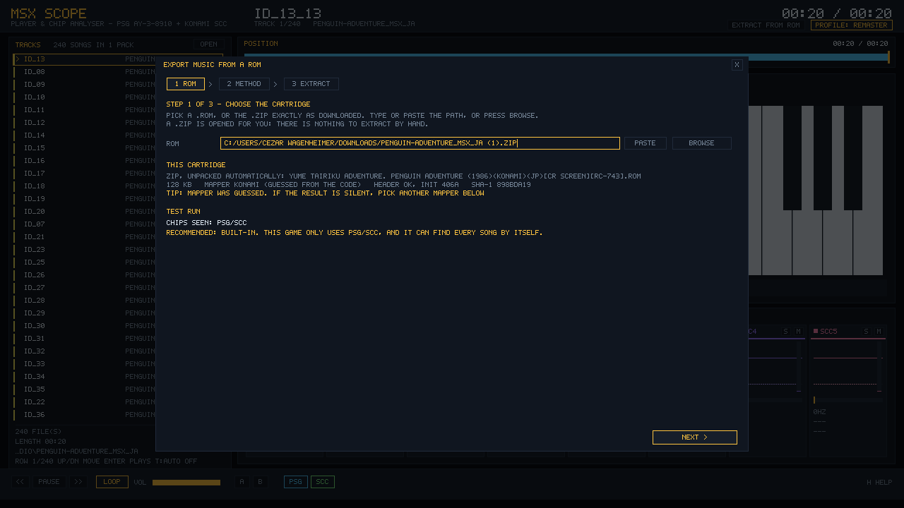</td>
<td width="50%">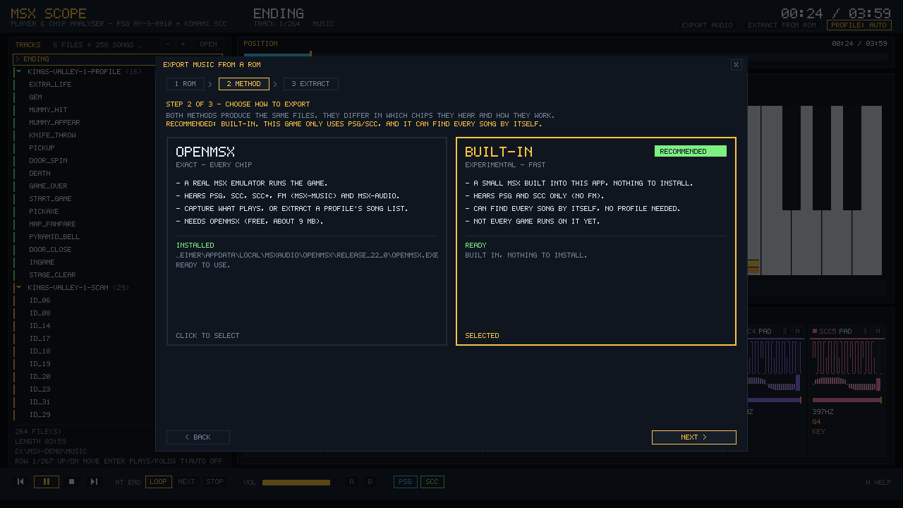</td>
</tr></table>

| Step | What you do | What the app does |
| :--- | :--- | :--- |
| **1 ROM** | pick a `.rom` or the `.zip` as downloaded (type, paste, browse) | opens the zip by itself; shows size, mapper (and where it came from), header and SHA-1; **runs the game for 8 s** to see which chips it uses |
| **2 METHOD** | choose **openMSX** or the **built-in extractor (experimental)** | recommends one from the test run; offers to **download and install openMSX** if it is missing |
| **3 EXTRACT** | press one button | picks what to run, shows a spinner, the time and the log, then opens the result in the player |

| Method | Chips it hears | Good for |
| :--- | :--- | :--- |
| **openMSX** | PSG, SCC, SCC+, MSX-MUSIC (FM), MSX-AUDIO | exact results and any game that uses FM; needs openMSX (free, ~9 MB) |
| **Built-in** | PSG and SCC | nothing to install, fast, and it can **find every song by itself** |

**openMSX is never bundled** (it is GPL). If it is not found (the setting, `MSXAUDIO_OPENMSX`, the install folder,
Program Files or `PATH`), step 2 shows **DOWNLOAD AND INSTALL**: the portable build is fetched from the
project's own GitHub releases, checked against its published size and SHA-256 and unpacked in
`%LOCALAPPDATA%\MsxAudio\openmsx` (no admin rights). **I ALREADY HAVE IT** takes a pasted path instead.

<table><tr>
<td width="50%">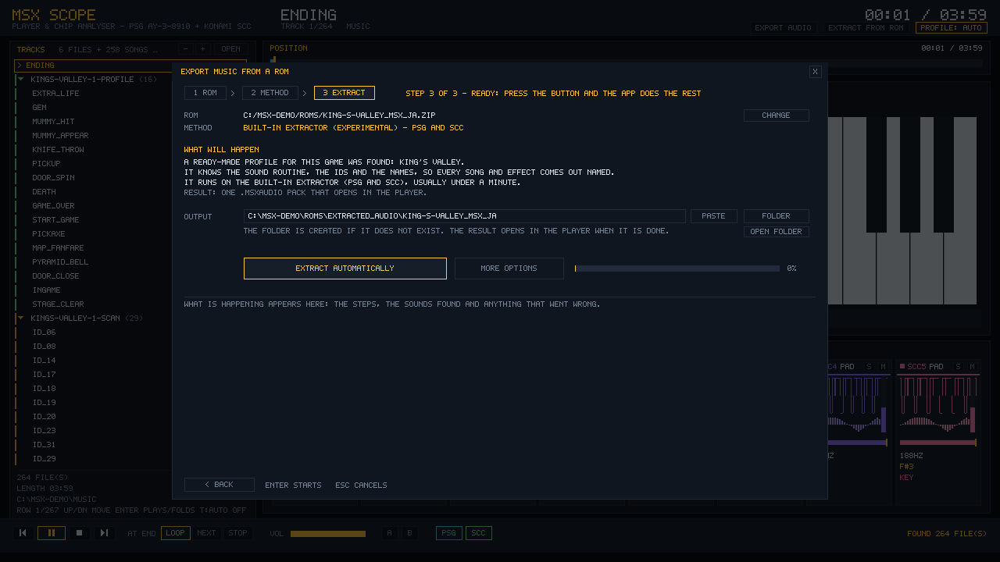</td>
<td width="50%">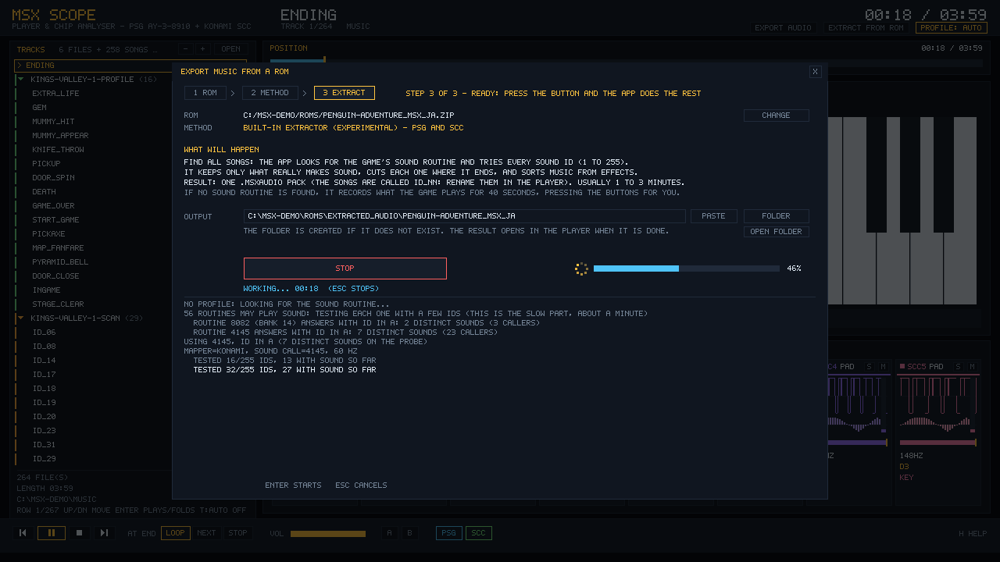</td>
</tr></table>

**Step 3 is automatic.** It says in plain words what will happen, and one button does it. The app chooses:

1. a **ready-made profile** whose `romSha1` matches the cartridge (the log says so: *"a ready-made profile for this
   game was found"*), so every song comes out **named**;
2. otherwise **FIND ALL SONGS** on the built-in extractor: it finds the game's "play sound" routine, tries every
   sound id (1 to 255) and keeps what really makes sound, cut where it ends, with music told from effects;
3. if no routine is found, it **records what the game plays** for 40 s, pressing the buttons for you;
4. with **openMSX** (which records but cannot search for ids) it makes a 45 s capture with every chip.

<table><tr>
<td width="50%">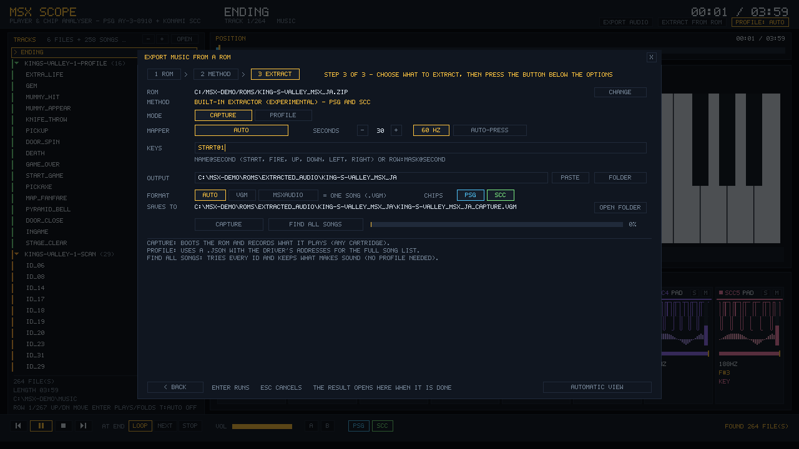</td>
<td width="50%">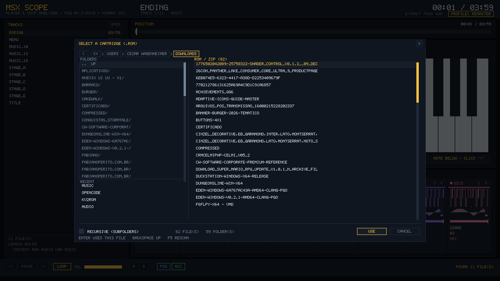</td>
</tr></table>

**MORE OPTIONS** opens the manual controls: capture / profile / scan, mapper, seconds, 50 or 60 Hz, the key script,
auto-press, output folder and format. The result is written to `<rom folder>/extracted_audio/<rom name>` and opens
straight in the player. When nothing plays, the log says **why** (missing header, a chip that is not emulated,
a BIOS service the game kept calling) instead of leaving you with a silent file.

### Keyboard and mouse

| Key | Action |
| :--- | :--- |
| `F2` / `Ctrl+O` | folder browser (recursive option inside) |
| `F3` | extract music from a ROM |
| `E` | **export audio** (WAV / MP3 / MIDI) |
| `F5` | rescan the current folder |
| `Up` / `Down` (hold to repeat), `PgUp` / `PgDn`, `Home` / `End` | move the track cursor |
| `Enter` (or click) | play the track under the cursor, or fold/unfold a pack header |
| `Left` / `Right` on a pack header | fold / unfold it |
| `T` | play every row the cursor lands on |
| `F4` / right-click | **rename** a song, a file or a pack |
| `Delete` | **delete** (a pack is rewritten; a plain file goes to the recycle bin) |
| `Space` | pause / resume |
| `X` | **stop** (back to 0:00, waits for play) |
| `,` and `.` | previous / next song |
| `Left` / `Right` | seek -/+ 5 s (rebuilds the chip state) |
| `L` | cycle **AT END**: loop, next, stop |
| `P` / `S` | toggle **PSG** / **SCC** |
| `1 2 3` / `4 5 6 7 8` | PSG / SCC channels (mute) |
| `O` / `Shift+O` | mixing profile dialog / next profile |
| `A` / `B` | set the **A-B loop** (`A` again clears it) |
| `Tab` (or the header) | spectrum -> piano roll -> piano |
| `R` | restart |
| `H` | help overlay |
| `Esc` | close a dialog, otherwise quit |

### Command line of the player

```bash
MSXScope "music/stage_a.vgm"                       # a file
MSXScope "C:\music\msx" --recursive                # a collection (every .vgm and .msxaudio below it)
MSXScope music/stage_a.vgm --profile auto          # original | stereo | remaster | auto
MSXScope music/stage_a.vgm --view piano            # spectrum | roll | piano
MSXScope music/stage_a.vgm --width 1600 --height 900

# record a GIF with the built-in encoder (no ffmpeg), silent by format
MSXScope music/stage_a.vgm --record out.gif --seconds 10 --fps 15

# record an MP4 *with sound*: frames + the very samples that are heard (out.wav) muxed by ffmpeg
# (without ffmpeg the frames and the WAV are kept and the exact command is printed)
MSXScope music/stage_a.vgm --record out.mp4 --seconds 20 --fps 30

# audio only, no window: render a segment to a WAV with the same chips and mix
MSXScope music/stage_a.vgm --audio-only out.wav --seconds 30 --profile auto
```

Recording is **deterministic**: every frame advances exactly `1/fps` seconds of music, whatever the frame rate of
the machine, so the WAV timeline matches the video.

<details>
<summary>Reproducing the screenshots of this README (environment variables)</summary>

```bash
MSXAUDIO_SHOT=shot.png MSXAUDIO_SHOT_FRAME=200 MSXScope music/stage_a.vgm        # one frame, then exit
MSXAUDIO_DIALOG=folder|profile|help|rom|extract MSXAUDIO_SHOT=...                 # open a dialog first
MSXAUDIO_ROM=game.zip MSXAUDIO_WIZARD_STEP=1|2 MSXAUDIO_METHOD=1 MSXAUDIO_ADVANCED=1
MSXAUDIO_EXTRACT=1|scan                          # start the extraction without a click
MSXAUDIO_EXPORT=wav,mp3,mid MSXAUDIO_EXPORT_DIR=out MSXAUDIO_EXPORT_RUN=1         # export dialog, and run it
MSXAUDIO_COLLAPSE=1  MSXAUDIO_EDIT=menu|rename|delete                             # packs folded / edit dialogs
```

A `visualizer.json` next to the executable keeps the settings (recent folders, ...) out of your profile.
</details>

---

## Using the library

**Render a VGM with a profile**

```csharp
using Wagenheimer.MsxAudio.Mixing;
using Wagenheimer.MsxAudio.Vgm;

VgmFile vgm = VgmFile.Load("stage_a.vgm");
RenderedAudio audio = MsxSoundRenderer.Render(vgm, AudioProfile.Auto, sampleRate: 48000);
// audio.Samples = interleaved 16-bit stereo, audio.Peak, audio.Seconds
```

**The auto mix, and what it decided**

```csharp
AutoMixPlan plan = AutoMixAnalyzer.Analyze(vgm);
Console.WriteLine(plan.Summary);                 // "LEAD SCC4  BASS SCC1  ARP SCC2,SCC3  PAD SCC5  DRUM PSG1"
Console.WriteLine($"{plan.Bpm} BPM, echo {plan.EchoLeftSeconds:0.000}/{plan.EchoRightSeconds:0.000} s");
foreach (ChannelMix c in plan.Channels)           // role, gain, pan, low cut, tone, drive, sends
    Console.WriteLine($"{c.Name}: {c.Role} {c.GainDb:+0.0;-0.0} dB pan {c.Pan:+0.00;-0.00}");
```

**Export**

```csharp
using Wagenheimer.MsxAudio.Export;

// WAV with the loop repeated twice and a 3 s fade, brought to -14 LUFS
RenderedAudio song = AudioExporter.Render(vgm, AudioProfile.Auto, 48000, loops: 2, fadeSeconds: 3);
song = LoudnessNormalizer.Normalize(song, targetLufs: -14.0, peakCeiling: 0.89);
File.WriteAllBytes("stage_a.wav", AudioExporter.ToWav(song));

double lufs = LoudnessMeter.IntegratedLufs(song);

// MIDI: tempo detected, notes on a 16th grid, arpeggios as chords
byte[] midi = MidiExporter.Export(vgm, "Stage A", new MidiOptions { Quantize = true, ArpeggiosAsChords = true });
File.WriteAllBytes("stage_a.mid", midi);

// or the notes themselves
List<TranscribedNote> notes = VgmTranscriber.Transcribe(vgm);
```

**Packages**

```csharp
var library = new MsxAudioLibrary("King's Valley");
library.AddSong("stage_a", "Stage A", vgm, loop: true, loopStart: 12.0, loopSeconds: 96.0, originalId: 5);
library.AddClip("jump", "Jump", jumpVgm);
library.Save("kingsvalley.msxaudio");

using var loaded = MsxAudioLibrary.Load("kingsvalley.msxaudio");
loaded.Find("stage_a")!.Name = "Stage A (remix)";
loaded.Remove("jump");
loaded.Save("kingsvalley.msxaudio");
```

**Extraction**

```csharp
using Wagenheimer.MsxAudio.Extraction;

RomInfo info = RomInfo.Analyze("game.zip");                  // size, SHA-1, mapper (+ source), header
var scan = RomSoundScan.Run(new RomScanOptions { RomPath = "game.zip" }, Console.WriteLine);
using var pack = scan.ToLibrary("Game");                      // one song or effect per id that made sound
pack.Save("game.msxaudio");

RomCaptureResult capture = RomCapture.Run(new RomCaptureOptions { RomPath = "game.zip", Seconds = 30, AutoPlay = true });
Console.WriteLine($"{capture.NoteWrites} notes; FM: {capture.UsesFm}, MSX-AUDIO: {capture.UsesY8950}, SCC+: {capture.UsesSccPlus}");

string? openMsx = OpenMsxLocator.Find();                    // a running install, or null
OpenMsxRelease release = await OpenMsxInstaller.GetLatestAsync();
string exe = await OpenMsxInstaller.InstallAsync(release, progress: null);   // portable build, SHA-256 checked
```

**Playback engine**

- **Streaming music**: the VGM is consumed while it plays; the loop is continuous (the chip state is never
  restarted). Each track costs only its VGM, with no pre-rendered PCM.
- **Sample player**: effects as PCM with volume, pan and polyphony (`MaxSampleVoices`, steals the oldest). An effect
  stored as a short VGM is rendered once and cached.
- **Volume buses**: `MusicVolume`, `SampleVolume`, `MasterVolume`. Profiles and per-channel gain changes apply
  without a pop.

## The `.msxaudio` format

A ZIP with a manifest and the VGMs:

```
manifest.json
songs/stage_a.vgm
clips/jump.vgm
```

`manifest.json` carries the title, origin, clocks and, per song, `name`, `loop`, `loopStart`, `loopSeconds`,
`seconds` and `originalId` (the id of the ROM's sound routine). Saving a loaded package rewrites the manifest
(an old copy kept from the file never shadows the new one).

---

## Extraction in depth

> **Deep dive:** [`docs/EXTRACTION.md`](docs/EXTRACTION.md): the machine, the mappers and how one is chosen,
> the three modes, the diagnosis report, what works per game and the known limits.

The machine (`MiniMsx`) models what the drivers touch: primary slots and 64 KB of RAM; the Konami, Konami SCC,
ASCII8, ASCII16 and R-Type mappers; the PPI (slot register, keyboard, joystick); the PSG with its read-back; the
VDP vblank; the BIOS entries games call; and **T-state timestamps** on every recorded write at 60 or 50 Hz.
The main program gets one frame of Z80 time (~60,000 T-states) per frame, like the hardware.

**Which mapper.** The cartridge is looked up by SHA-1 in an openMSX `softwaredb.xml` when one is found, and
guessed with openMSX's own vote (`LD (nn),A` stores to the bank registers) otherwise. A 40 to 56 KB image cannot
fit the 0x4000-0xBFFF window, so it is voted on too (the SCC release of *Knightmare* is 56 KB: seven 8 KB banks).

| Mode | What it does | When to use |
| :--- | :--- | :--- |
| **CAPTURE** | boots the ROM and records what it plays after a key script | any cartridge; a title theme or a gameplay window |
| **PROFILE** | reads a `.json` with the driver's addresses, ids and names | the full song list, with names (see `profiles/`) |
| **FIND ALL SONGS** | finds the "play sound" routine (in any ROM bank, id in `A`/`HL`/`DE`/`BC`), then probes every id | no profile yet: a first list named `id_NN` |

While scanning, the game's own calls to the sound routine are **ignored** (a game on its title screen starts its
own music after a few seconds and it would replace or mix with the id being tested), every id runs on a fresh
machine in parallel, a sound is cut where it ends, only real audio counts (volume above zero with a voice on), and the
scan gives up after 48 ids without a sound.

### Key scripts and profiles

| Key script | Meaning |
| :--- | :--- |
| `START@1` | joystick trigger A one second after boot (the usual "press start") |
| `FIRE@1, RIGHT@3` | several presses, comma separated |
| `TRIGGER-B@2` | the second joystick button |
| `UP` / `DOWN` / `LEFT` / `RIGHT` | joystick directions (`@seconds` optional, default 1 s) |
| `8:1@2` | raw matrix: keyboard **row 8, bit 1**, two seconds after boot |

A profile (`profiles/*.json`) names the driver's addresses so a game can be extracted completely, with names and
durations. `profiles/kingsvalley2.json`:

```json
{
  "name": "King's Valley II",
  "romSha1": [ "cfd872d005b7bd4cdd6e06c4c0162191f0b0415d" ],
  "soundCallAddress": 17198,
  "stopId": 1,
  "ids": [1,2,3,4,5,6,7,8,9,10,11,12,13,14,15,16,17,18,19,20],
  "musicIds": [3,5,6,7,8,9,10,13,14,17,18],
  "secondsPerId": 12,
  "secondsPerSong": 120,
  "secondsById": { "9": 300 }
}
```

`romSha1` makes the player **pick the profile by itself** when that ROM is chosen. Other fields:
`soundCallBank`, `idRegister` (`A`/`HL`/`DE`/`BC`), `playerAddress` (run only the sound driver, for games whose
interrupt handler also runs the whole game, like King's Valley 1), `resetAddresses`, `idMask`, `romType` and
`refreshRate`. Songs with long loops need longer captures (`secondsById`).

### Status per game

| Game | Cartridge | Result |
| :--- | :--- | :--- |
| King's Valley 1 | 16 KB, linear, PSG | capture OK; profile: **8 songs + 8 effects**; the scan finds `setMusic` by itself (29 sounds) |
| King's Valley II | 128 KB, Konami SCC | capture OK (5.9k pitch writes in 15 s); profile: the full named list |
| Penguin Adventure | 128 KB, Konami (4), PSG | the scan finds the routine (`4145`, id in `A`) and **213 sounds** in ~90 s; effects 0.4-2.5 s, music from id 59 on |
| Knightmare (SCC release) | 56 KB, Konami SCC | capture OK (3.7k pitch writes in 40 s); the scan does not find a play-by-id routine, so the automatic mode records instead |

Games whose music is on **MSX-MUSIC, MSX-AUDIO, SCC+ or MoonSound** are detected and reported, and recorded
through openMSX. The in-process machine does not record them yet.

---

## CLI tool

```bash
MsxAudioTool import <vgm-folder> <out.msxaudio> [--title T] [--clips] [--manifest audio.json]
MsxAudioTool info <package.msxaudio>
MsxAudioTool extract <rom> <out.msxaudio> --profile profile.json [--openmsx path]
MsxAudioTool extract-direct <rom> <out.msxaudio> --profile profile.json
MsxAudioTool capture <rom> <out.vgm> [--seconds N] [--mapper M] [--keys "START@1,RIGHT@3"] [--auto 1] [--refresh 50|60]
MsxAudioTool scan <rom> <out.msxaudio> [--ids 1-255] [--call ADDR] [--bank N] [--id-reg A|HL|DE|BC]
                  [--player ADDR] [--profile p.json] [--refresh 50|60] [--seconds N]
MsxAudioTool probe <rom> [--mapper M] [--refresh 50|60]
MsxAudioTool rom-info <rom>
MsxAudioTool render <package.msxaudio> <id|all> <out.wav> [--profile original|stereo|remaster|auto]
MsxAudioTool verify <vgm> <capture.wav>
MsxAudioTool unpack <package.msxaudio> <folder>
```

```bash
MsxAudioTool rom-info "rom.zip"                                            # size, SHA-1, mapper and its source, header
MsxAudioTool capture "rom.zip" title.vgm --seconds 40 --auto 1             # tap fire/space by itself
MsxAudioTool scan game.rom game_songs.msxaudio --seconds 12                # every sound id, no profile needed
MsxAudioTool extract-direct "rom.msx" game.msxaudio --profile profiles/kingsvalley2.json
MsxAudioTool probe "rom.msx"                                               # mapper, hooks, hot addresses, what is missing

# the same extraction, driven through openMSX (the emulator does the VDP, CPU, mapper and every chip)
MsxAudioTool extract "King's Valley II.rom" kingsvalley.msxaudio --profile profiles/kingsvalley2.json --openmsx path/to/openmsx.exe
```

## Validation

Against openMSX recordings of the same VGM:

| Measurement | Result |
| :--- | :--- |
| LTAS (mean spectral shape) | correlation **0.998** |
| Amplitude envelope | correlation **0.95** (constant offset about the `record` latency) |
| Level | **0.3 dB** difference (calibrated in `AudioProfile.DefaultMasterGain`) |
| Loop seam (one round render) | jump **0.025** against a typical delta of **0.047** |
| Loudness meter | a stereo 1 kHz sine at -20 dBFS reads **-19.99 LUFS** (BS.1770 expects -20.0) |

Sample-by-sample correlation is not a valid metric here: openMSX's `record` resamples and delays, and a fraction of a
millisecond misaligns a square wave.

## Architecture

```
src/Wagenheimer.MsxAudio/             core (pure C#, no engine dependency)
  Chips/       Ay8910, KonamiScc
  Vgm/         VgmFile, VgmWriter, VgmLoopFinder
  Mixing/      AudioProfile, MsxSoundRenderer, AutoMix (analyzer + processor), Loudness (LUFS),
               FirDecimator, Biquad, StereoReverb
  Export/      AudioExporter (loops, fade, WAV), MidiExporter + VgmTranscriber
  Songs/       MsxAudioLibrary (.msxaudio)
  Playback/    MsxAudioEngine, WavDecoder
  Extraction/  MiniMsx (the machine), RomMapper, RomInfo (+ softwaredb), RomCapture, RomSoundScan,
               DirectRomExtractor (+ profiles), OpenMsx (locator, installer, capture), OpenMsxRomExtractor, VgmImporter
src/Wagenheimer.MsxAudio.MonoGame/    MsxAudioPlayer (DynamicSoundEffectInstance)
tools/MsxAudioTool/                   extractor / import / export CLI
tools/MsxAudioVisualizer/             MSXScope: MonoGame visual player (views, track list, export, assistant)
tests/Wagenheimer.MsxAudio.Tests/     chips, VGM, package, engine, MSX machine, mixing, export, loudness
profiles/                             per-game extraction profiles (JSON, with the ROM hashes)
docs/                                 EXTRACTION.md (deep dive), screenshots
```

## Versioning

The library follows [Semantic Versioning](https://semver.org/) (`Wagenheimer.MsxAudio` is at 1.1.0) and the changelog is in
[CHANGELOG.md](CHANGELOG.md). **MSXScope** takes its version from the git tag through
[MinVer](https://github.com/adamralph/minver):

```bash
MSXScope --version                          # e.g. 1.0.0, or 1.0.1-alpha.0.7 between tags
git tag v1.2.0 && git push origin v1.2.0    # publishes a release with the six archives
```

`v*` tags produce a GitHub Release; commits after a tag are versioned `<next>-alpha.0.<commit count>`, so every build is
traceable to a commit without hand-editing a version file.

## Status and roadmap

| Area | State |
| :--- | :--- |
| PSG + SCC emulation | validated against openMSX (LTAS correlation 0.998) |
| VGM import/export, loop detection | done |
| `.msxaudio` package (read, write, edit) | done |
| Streaming engine + sample player, MonoGame bridge | done (parity test with the offline renderer) |
| Visual player (views, track list, packs, rename/delete, transport) | done |
| Mixing: original, stereo, remaster, **auto** (roles, tempo echo, loudness) | done; tuned by measurement, not yet by ear on every game |
| Export WAV / MP3 / MIDI | done (MP3 needs LAME) |
| ROM extraction through openMSX | done (bit-exact reference path; can install openMSX) |
| ROM extraction in process (PSG + SCC) | capture, profile and scan; slots, 6 mappers, T-state timing, 50/60 Hz |
| ROM extraction: MSX-MUSIC / MSX-AUDIO / SCC+ in process | detected and reported, not recorded yet (use openMSX) |

### Roadmap

1. **A band for the MIDI**: render the transcription with a SoundFont (the notes are already exact).
2. A mixer panel with sliders per channel and role, saved per game, with an instant A/B.
3. Record MSX-MUSIC (YM2413) and SCC+ in the in-process machine (VGM already has the commands).
4. Find a game's per-frame sound player automatically, so the scan can silence the game's own music.
5. A hybrid extraction: the built-in scan finds the routine and the ids, openMSX records each one with every chip.
6. A `play` CLI command that streams through `MsxAudioEngine`; an optional `SoundEffect`-based player.

## Tests

```bash
dotnet test MsxAudio.slnx      # 94 tests
```

Covers chip frequencies (PSG/SCC formulas), VGM parse/write round trip, loop detection, package IO (including edit
and save), the streaming engine (loop continuity, sample voices, volume), streaming vs offline parity, WAV decoding,
the built-in MSX machine (every mapper, the SCC window rule, slots and `ENASLT`, the PPI, PSG read-back, `HALT`
timing, T-state timestamps, 50/60 Hz, mapper detection including odd-sized ROMs, the diagnosis, the bank-aware
sound scan), the **auto mix** (roles, tempo, echo timing), **loudness** (LUFS of a sine, gating, normalisation),
**MIDI** (tracks, notes, chords, pitch bend, expression, tempo and grid) and the **openMSX locator**.

## Credits and legal

- **emu2149** (PSG), **MAME / libvgm** (SCC), **openMSX** (reference and `softwaredb.xml`), **MonoGame**,
  **LAME** through `NAudio.Lame` (MP3), **MinVer**.
- MSX games, their art and their music belong to their authors (Konami, for King's Valley and Knightmare). This package
  does **not** ship ROMs or extracted data: it emulates the chips and reads VGM files and packages that **you** generate
  from your own ROM. Use it only with material you are allowed to use.
- openMSX is GPL and is never bundled; the installer in the player fetches it from the project's own releases when you ask.
