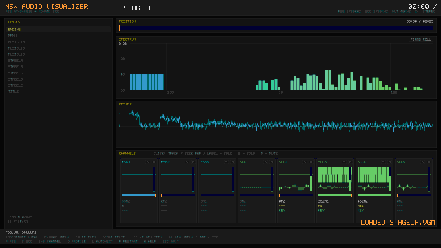

# Wagenheimer.MsxAudio

**MSX audio for .NET** — AY-3-8910 (PSG) and Konami SCC emulation, VGM playback/recording, ROM music
extraction and a game-ready streaming engine with its own `.msxaudio` library format.

[](https://www.nuget.org/packages/Wagenheimer.MsxAudio)
[](https://www.nuget.org/packages/Wagenheimer.MsxAudio.MonoGame)
[](https://www.nuget.org/packages/Wagenheimer.MsxAudio)
[](LICENSE)
[](#requirements)
[](#architecture)

```bash
dotnet add package Wagenheimer.MsxAudio            # engine-agnostic core (pure C#)
dotnet add package Wagenheimer.MsxAudio.MonoGame  # optional MonoGame bridge
```

<p align="center"></p>

---

## Table of contents

- [Why this package exists](#why-this-package-exists)
- [The chips](#the-chips)
- [Requirements](#requirements)
- [Quick start](#quick-start)
- [Visual player (MonoGame)](#visual-player-monogame)
- [The `.msxaudio` format](#the-msxaudio-format)
- [Playback engine](#playback-engine)
- [Extracting music from a ROM](#extracting-music-from-a-rom)
- [CLI](#cli)
- [Mixing profiles](#mixing-profiles)
- [Validation](#validation)
- [Architecture](#architecture)
- [Status and roadmap](#status-and-roadmap)
- [Tests](#tests)
- [Legal](#legal)

---

## Why this package exists

MSX game audio *is what the chips played* — not a recording. This package stores and plays the
**register writes** (the VGM), which is the lossless source of truth: a few KB per song, a sample
accurate loop, and the exact timbre on any machine, with no codec in between.

| Problem with the "record a WAV/OGG" route | How this package solves it |
| :--- | :--- |
| click at the loop seam (time based cut) | the loop is detected in the write stream, and the streaming engine **never restarts the chip** (continuous loop) |
| codec artefacts, inconsistent level | chip render at 4–8× oversampling + FIR decimation, level calibrated to hardware |
| hundreds of MB of rendered audio | a few KB of VGM, rendered in real time |
| losing the extraction | a `.msxaudio` (ZIP) package with a manifest + VGMs, versionable |

## The chips

| Chip | Implementation | What is emulated |
| :--- | :--- | :--- |
| **PSG AY-3-8910** | port of **emu2149** (the same core used by VGMPlay) | 3 square channels, 17-bit LFSR noise, 16 envelope shapes, the AY volume table |
| **Konami SCC (K051649)** | port of the **MAME/libvgm** core | 5 wavetable channels (32 bytes each), 16.16 phase accumulator, key-on at `0x8F`, channel 5 sharing the wave of channel 4 |

MSX clocks: PSG **1,789,772.5 Hz** (divide by 16) and SCC **1,789,772.5 Hz** in VGMs
(`f = clock / (16 × (period + 1))`, equivalent to `3579545 / (32 × (period + 1))`).

## Requirements

| Piece | Version |
| :--- | :--- |
| .NET | **10** (`net10.0`) |
| MonoGame (only for the bridge and the visualizer) | 3.8 (`MonoGame.Framework.DesktopGL`) |
| openMSX (only for ROM extraction) | 19+ (portable build works) |

The core has **no engine dependency** and targets `net10.0` with nullable enabled.

## Quick start

```csharp
using Wagenheimer.MsxAudio.Songs;
using Wagenheimer.MsxAudio.Playback;
using Wagenheimer.MsxAudio.Mixing;

using var library = MsxAudioLibrary.Load("Content/Audio/kingsvalley.msxaudio");
using var engine  = new MsxAudioEngine(library, AudioProfile.Original);

engine.PlaySong("stage_a");     // loop handled by the manifest
engine.PlaySample("jump");      // short VGM or WAV clip
```

MonoGame bridge:

```csharp
using Wagenheimer.MsxAudio.MonoGame;

var player = new MsxAudioPlayer(engine);   // DynamicSoundEffectInstance (streaming)
player.Start();
player.PlaySong("menu");
player.PlaySample("password_key");

// in Update():
player.Update();                           // keeps the buffer queue full
```

`Render(float[] destination, int frames)` also gives you **interleaved stereo** if you want to feed
another backend (SDL, NAudio, a custom mixer, the visualizer…).

## Visual player (MonoGame)

`tools/MsxAudioVisualizer` opens a **VGM** (file, folder or *drag & drop*), plays it in real time and
shows everything the chips are doing. **F2** (or the `OPEN` button in the playlist) opens an in-app
folder browser with a **recursive** option, so you can browse a whole collection without leaving the
player; the last folder, view, profile and window size are remembered between runs
(`%APPDATA%\MsxAudio\visualizer.json`, or a `visualizer.json` next to the executable for a portable
install).

| Key | Action |
| :--- | :--- |
| `F2` / `Ctrl+O` | open the **folder browser** (recursive option inside) |
| `F5` | rescan the current folder |
| `↑` / `↓` | select and play a track |
| `PgUp` / `PgDn` (or the wheel / scrollbar) | scroll the track list without changing the song |
| `Enter` (or click) | play the selected track |
| `Space` | pause / resume |
| `←` / `→` | seek -/+ 5 s (rebuilds the chip state) |
| `P` / `S` | toggle **PSG** / **SCC** |
| `1 2 3` | PSG channels 1..3 |
| `4 5 6 7 8` | SCC channels 1..5 |
| `O` | **mixing profile dialog** (with the details of each profile) |
| `Shift+O` | cycle the profile without opening the dialog |
| `A` / `B` | set the **A-B loop** at the current position (`A` twice clears it) |
| `L` | auto-next |
| `Tab` (or the header button) | cycle **spectrum** → **piano roll** → **piano** |
| `R` | restart |
| `H` | help overlay |
| `Esc` | close a dialog, otherwise quit |

In the **piano** view:

| Action | Result |
| :--- | :--- |
| click **and hold** a key | plays that note with the **selected channel's instrument** for as long as you hold it (works while paused); drag across the keys to slide |
| `PSG1…SCC5` | selects which channel's instrument the keys use |
| `PLAY ALL` | walks the **audible** channels, playing each instrument at the note the song is using |
| `<` / `>` | shifts the keyboard one octave (3 octaves on screen) |

What you see:

- **POSITION** bar with `current / total`, the loop window and a marker — click or drag to seek;
- the **transport bar** at the bottom: previous / play-pause / next, **LOOP**, **volume**, the
  **A-B loop** (its A/B points also appear on the POSITION bar) and the **PSG / SCC** chip toggles.
  The track list scrolls with the wheel, `PgUp`/`PgDn` or its draggable scrollbar;
- **SPECTRUM** in **dB** (`0` to `-60 dB`) with a frequency axis at **100 Hz / 1 kHz / 10 kHz** and
  **peak-hold caps**, so the quiet harmonics and short transients stay visible;
- **PIANO ROLL**: the last 12 s with a **mini keyboard** on the left, octave lines, time grid, one
  colour per channel, and a short tail on every note so fast arpeggios stay **stacked as chords**;
  muted/soloed channels draw dimmed. Under it, a **whole-song map** (one row per channel, brightness =
  activity) shows where the song is busy and where it is calm — **click or drag it to jump** anywhere;
- **PIANO** with three octaves: the bars under each key show which **notes the song is playing** right
  now (one colour per channel, **stacked** when two channels play the same note), and clicking a key
  auditions that instrument — the same PSG envelope/ noise and SCC wave the song uses, mixed over the
  music. The note lasts as long as the mouse button is held. **Mute/solo also apply here**: a muted
  channel (or one filtered out by solo) stops lighting its keys and fades its selector, so the
  keyboard shows exactly what is being heard. The footer has **PSG / SCC** buttons (same as the
  `P` / `S` keys) to mute a chip;
- the **MASTER** oscilloscope and the per-channel scopes draw a **min/max envelope** per pixel column,
  so peaks stay visible instead of being averaged away;
- one strip per channel with live oscilloscope, volume, level with **peak hold**, frequency, nearest
  **note**, key state and — for SCC — the **32-sample wave RAM**. Each channel has its **own colour**
  (PSG warm, SCC cool) and the strip is painted with it — the strip header works as the legend for the
  roll and the piano, which use the same palette;
- **Solo** by clicking a channel label (or its `S` button) and **Mute** through the `M` button.

The UI renders to a fixed **1280×720** render target and is letterboxed into the window, so
resizing/maximising never moves anything.

```bash
# live
dotnet run --project tools/MsxAudioVisualizer -- "music/stage_a.vgm"

# screenshot for docs/CI
MSXAUDIO_SHOT=shot.png MSXAUDIO_SHOT_FRAME=200 dotnet run --project tools/MsxAudioVisualizer -- "music/stage_a.vgm"

# record a GIF with the built-in encoder (no ffmpeg needed), 640×360 — GIF is silent by format
MsxAudioVisualizer music/stage_a.vgm --record out.gif --seconds 10 --fps 15

# record an MP4 **with audio**: the same samples that are heard go to out.wav and ffmpeg muxes
# frames + WAV (without ffmpeg the frames and the WAV are kept and the exact command is printed)
MsxAudioVisualizer music/stage_a.vgm --record out.mp4 --seconds 20 --fps 30

# audio only (no window): renders the segment to a WAV using the same chips/profile
MsxAudioVisualizer music/stage_a.vgm --audio-only out.wav --seconds 30 --profile remaster

# window size
MsxAudioVisualizer music/stage_a.vgm --width 1600 --height 900

# start with the piano roll instead of the spectrum
MsxAudioVisualizer music/stage_a.vgm --roll

# start on the playable piano
MsxAudioVisualizer music/stage_a.vgm --view piano

# open a collection (all .vgm below the folder)
MsxAudioVisualizer "C:\music\msx" --recursive
```

Recording is **deterministic**: every frame advances exactly `1/fps` seconds of music, independent of
the machine frame rate — so the WAV timeline matches the video exactly.

## The `.msxaudio` format

A ZIP with a manifest and the VGMs:

```
manifest.json
songs/stage_a.vgm
clips/jump.vgm
```

`manifest.json` carries the title, origin, clocks and, per song, `loop`, `loopStart`, `loopSeconds`,
`seconds` and `originalId` (the id of the ROM's sound routine).

## Playback engine

- **Streaming music**: the VGM is consumed while it plays; the loop is continuous (the chip state is
  never restarted). Each track costs only its VGM — no pre-rendered PCM.
- **Sample player**: effects as PCM with volume, pan and polyphony (`MaxSampleVoices`, steals the
  oldest). An effect stored as a short VGM is rendered once and cached.
- **Volume buses**: `MusicVolume`, `SampleVolume`, `MasterVolume`.
- **Mute/solo aware**: profiles and per-channel gain changes apply without a pop.

## Extracting music from a ROM

The extractor drives **openMSX** (the emulator does the hard part: VDP, CPU, mapper, SCC) and injects
`CALL <sound routine>` with each id, recording the VGM. What changes from game to game lives in a
**JSON profile** (how to reach a silent screen, the routine address and the ids) — no recompiling.

```bash
MsxAudioTool extract "King's Valley II (JP)[RC-760].rom" kingsvalley.msxaudio \
    --profile profiles/kingsvalley2.json --openmsx tools/omsx/openmsx.exe
```

`profiles/kingsvalley2.json` (a real example, Konami 1988):

```json
{
  "name": "King's Valley II",
  "machine": "C-BIOS_MSX2_JP",
  "soundCallAddress": 17198,
  "stopId": 1,
  "ids": [1,2,3,4,5,6,7,8,9,10,11,12,13,14,15,16,17,18,19,20,21,22,23,24,25,26,27,28,29,30],
  "musicIds": [3,5,6,7,8,9,10,13,14,17,18],
  "secondsPerId": 12,
  "secondsPerSong": 120,
  "secondsById": { "9": 300 },
  "firstCaptureAt": 23,
  "navigation": [
    { "at": 12, "row": 8, "mask": 1 },
    { "at": 16, "row": 8, "mask": 1 },
    { "at": 19, "row": 8, "mask": 64 },
    { "at": 20.5, "row": 8, "mask": 1 }
  ]
}
```

> Songs with long loops need longer captures (KV2's `stage_e` only reveals its 67.287 s loop with
> 300 s of recording). Use `secondsById` for that.

### Direct extraction, no external emulator (experimental)

`extract-direct` runs the **cartridge's own sound driver in process**: a minimal MSX1 machine
(Z80 core + Konami SCC mapper + 16 KB RAM + PSG/SCC capture + BIOS entry stubs for `RST 30h`,
`WRTPSG` and `RDPSG`) boots the ROM, installs the interrupt hook and records the register writes —
no openMSX, no window.

```bash
MsxAudioTool extract-direct "rom.msx" game.msxaudio --profile profiles/kingsvalley2.json
```

Status: **works** (it boots King's Valley II, runs the driver, captures ~97k writes in 100 s and
renders audio), but the VDP vblank flag/status is not modelled yet, so the driver runs ~6% off the
hardware tempo and the loop is not detected. The `extract` path (openMSX) remains the bit-exact
reference.

## CLI

```bash
MsxAudioTool import <vgm-folder> <out.msxaudio> [--title T] [--clips]
MsxAudioTool info <package.msxaudio>
MsxAudioTool extract <rom> <out.msxaudio> --profile profile.json [--openmsx path]
MsxAudioTool extract-direct <rom> <out.msxaudio> --profile profile.json
MsxAudioTool render <package.msxaudio> <id|all> <out.wav> [--profile original|stereo|remaster]
MsxAudioTool verify <vgm> <capture.wav>
MsxAudioTool unpack <package.msxaudio> <folder>
```

## Mixing profiles

| Profile | What changes |
| :--- | :--- |
| `original` | faithful: all 8 channels centred, only the DC cut |
| `stereo` | PSG at −30/0/+30 % and SCC at −55/−25/0/+25/+55 % + 16 kHz low-pass |
| `remaster` | 8× oversampling, wider pan, 17 kHz low-pass, short reverb, peak normalisation |

> Profiles only change **how** the chips are mixed. The chips themselves are toggled with `P` / `S`
> (or the **PSG / SCC** buttons in the transport bar of the visualizer).

## Validation

Against openMSX recordings of the same VGM:

| Measurement | Result |
| :--- | :--- |
| LTAS (mean spectral shape) | correlation **0.998** |
| Amplitude envelope | correlation **0.95** (constant offset ≈ `record` latency) |
| Level | **0.3 dB** difference (calibrated in `AudioProfile.DefaultMasterGain`) |
| Loop seam (one round render) | jump **0.025** against a typical delta of **0.047** |

Sample-by-sample correlation is not a valid metric here: openMSX's `record` resamples and delays, and
a fraction of a millisecond misaligns a square wave.

## Architecture

```
src/Wagenheimer.MsxAudio/             core (pure C#, no engine dependency)
  Chips/       Ay8910, KonamiScc
  Vgm/         VgmFile, VgmWriter, VgmLoopFinder
  Mixing/      AudioProfile, MsxSoundRenderer, FirDecimator, Biquad, StereoReverb
  Songs/       MsxAudioLibrary (.msxaudio)
  Playback/    MsxAudioEngine, WavDecoder
  Extraction/  VgmImporter, OpenMsxRomExtractor, DirectRomExtractor (+ profiles)
src/Wagenheimer.MsxAudio.MonoGame/    MsxAudioPlayer (DynamicSoundEffectInstance)
tools/MsxAudioTool/                   extractor/import/export CLI
tools/MsxAudioVisualizer/             MonoGame visual player (PSG/SCC per channel, GIF export)
tests/Wagenheimer.MsxAudio.Tests/     chips, VGM, package, engine, MSX machine
profiles/                             per-game extraction profiles (JSON)
```

## Status and roadmap

| Area | State |
| :--- | :--- |
| PSG + SCC emulation | ✅ validated against openMSX (LTAS correlation 0.998) |
| VGM import/export, loop detection | ✅ |
| `.msxaudio` package | ✅ |
| Streaming engine + sample player | ✅ (parity test with the offline renderer) |
| MonoGame bridge | ✅ |
| Visual player (per-channel view, GIF/MP4 export) | ✅ |
| ROM extraction via openMSX | ✅ (bit-exact reference path) |
| ROM extraction in process | 🧪 experimental (tempo ~6 % off; VDP vblank not modelled) |
| Remaster profile (stereo/reverb) | ✅ |

### Roadmap

1. Model the VDP vblank flag/status and the BIOS interrupt chain so `extract-direct` matches the
   hardware cadence (then loop detection works and no external emulator is needed).
2. A `play` CLI command that streams through `MsxAudioEngine` (live preview).
3. Optional `SoundEffect`-based player for projects that cannot use `DynamicSoundEffectInstance`.
4. A "song map" view in the roll (density per channel over the whole track, jump by clicking it).

## Tests

```bash
dotnet test MsxAudio.slnx
```

Covers chip frequencies (PSG/SCC formulas), VGM parse/write round-trip, loop detection, package IO,
the streaming engine (loop continuity, sample voices, volume), streaming vs offline parity, the
built-in MSX machine (mapper, PSG/SCC capture, id pass-through) and WAV decoding.

## Legal

MSX games, their art and their music belong to their authors (Konami, for King's Valley). This
package does **not** ship ROMs or extracted data: it emulates the chips and reads VGM files and
packages that **you** generate from your own ROM. Use it only with material you are allowed to use.
